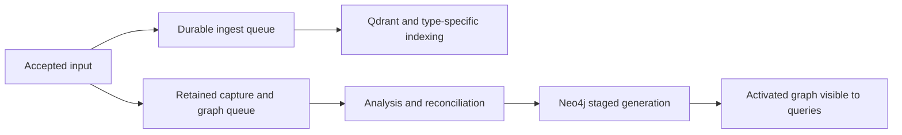

# Runtime artifacts

## Locate the deployment

Read the effective launch arguments, configuration, mounts, and deployed revision without printing
secrets. `--data-dir` overrides `DATA_DIR`; relative selections resolve beneath the platform default,
not the shell working directory. `/data`, when present, is the default; otherwise macOS uses
`~/Library/Application Support/shyhurricane`, Linux uses
`${XDG_STATE_HOME:-~/.local/state}/shyhurricane`, and Windows uses its local application-data directory.
Compose retains separate named volumes, so do not assume everything is physically under `/data`.

| Existing configuration | Meaning |
|---|---|
| `DATA_DIR` / `--data-dir` | Application state root; command-line argument wins |
| `LOG_FILE` / `--log-file` | Diagnostic file override; command-line argument wins; relative to working directory |
| `QDRANT` | External host:port; local managed storage otherwise uses `<data-dir>/qdrant` |
| `NEO4J` | External Bolt/Neo4j URI; local managed storage otherwise uses `<data-dir>/graph` |
| `TOOL_CACHE` | Compose compatibility storage override; inspect actual cache mounts |
| `INDEXING_WAIT_TIMEOUT_SECONDS` | Retrieval indexing-wait budget; zero disables waiting |
| `GRAPH_LIBRARY_ANALYSIS` | Summary/full analysis policy; inspect deployed configuration and capture policy |
| `NEO4J_HEAP_SIZE`, `NEO4J_PAGECACHE_SIZE`, `NEO4J_TRANSACTION_MEMORY_LIMIT` | Managed/Compose memory settings; external servers configure their own budgets |

See README sections Application data directory, File logging, Status Endpoint, and Application
Relationship Graph for full defaults and semantics. Confirm behavior against deployed source.

## Artifact map

| Artifact | Evidence and limitations |
|---|---|
| `<data-dir>/logs/shyhurricane.log` or log override | DEBUG+ application diagnostics, logged tracebacks, process/PID, access messages; no automatic rotation; raw subprocess output and unlogged exceptions may be absent |
| `<data-dir>/logs/index-*.jsonl`, `finding-*.jsonl` | Index/finding records grouped by startup UTC filename timestamp; inspect record shape before filtering |
| `<cache-path>/history.jsonl` | Tool names, arguments, and timestamps; not proof of completion; serialization can fall back to repr, so handle malformed/non-JSON lines |
| `<cache-path>/result_pages/` | Saved bounded result snapshots with original indexing status and expiration; reading a snapshot does not refresh indexing |
| `<data-dir>/queues/<queue-name>/data.db` | Persistent queue status and encoded payloads; inspect using read-only SQLite |
| `<data-dir>/graph_state/artifacts.sqlite` and referenced JSON files | Captures, references, work status/errors, analysis policies, bodies, and reanalysis scheduler state |
| Managed Neo4j `graph/logs/` or Compose `neo4j-logs` | Database failures and memory/transaction diagnostics; inspect actual mount |
| Qdrant and Neo4j | Vector documents versus versioned graph publications; counts are not interchangeable |
| Existing `/status` and container metrics/logs | Current readiness, queues, counts, memory and CPU; samples are time-dependent and not an atomic cross-store snapshot |

Diagnostic/history timestamps may lack timezone offsets. Establish the emitting process timezone;
do not infer UTC from an index/finding filename or correlate solely by timestamp proximity.



Treat this as a correlation map; verify exact producer ordering and commit boundaries in source.

## Logs and status

After substituting the verified diagnostic path, use a bounded search such as:

```sh
rg -n -m 40 -C 8 'Traceback|ERROR|WARNING|capture=<capture-id>' '/absolute/log/path'
```

Increase context around a selected occurrence until the complete exception chain is captured;
the first bounded excerpt may cut off the cause. Search by literal identifiers with `rg -F` when
they contain regex characters. Check rotated/exported and container logs if supplied.

The existing service exposes a read-only status operation via POST:

```sh
curl --max-time 15 -fsS -X POST http://127.0.0.1:8000/status
docker stats --no-stream <verified-container-name>
docker logs --since 10m --tail 200 <verified-container-name>
```

Use the actual endpoint/container; do not start services or dump container environments. `/status`
can refresh cached monitoring information, but does not enqueue ingestion. Missing queue databases
count as zero; read failures are errors. Unavailable counts are not zero. Graph counts may be
cached, approximate, partial, or stale. Do not use broad graph scans to validate estimates.

## Read-only queue and artifact queries

Queue directories are `ingest_queue`, `doc_type_queue`, `scan_finding_queue`, and `graph_queue`.
The following Python example opens an existing database without constructors or payload decoding.
Run from the repo using its UV environment; substitute a verified absolute path.

```sh
UV_CACHE_DIR="$PWD/.uv-cache" uv run python - <<'PY'
import sqlite3
from pathlib import Path

database = Path("/absolute/data/queues/ingest_queue/data.db")
connection = sqlite3.connect(database.as_uri() + "?mode=ro", uri=True, timeout=5)
try:
    connection.execute("PRAGMA query_only=ON")
    connection.set_progress_handler(lambda: 1, 2_000_000)
    print(connection.execute("PRAGMA table_info(ack_queue_default)").fetchall())
    print(connection.execute(
        "SELECT status, COUNT(*) FROM ack_queue_default GROUP BY status"
    ).fetchall())
    print(connection.execute(
        "SELECT _id, status FROM ack_queue_default WHERE status = 9 ORDER BY _id LIMIT 20"
    ).fetchall())
finally:
    connection.close()
PY
```

The progress handler interrupts a query after a bounded number of virtual-machine instructions;
the connection timeout limits lock waiting. Report interruption as incomplete evidence, never zero.
Even aggregation returning few rows may scan many records; prefer indexed predicates when possible.
Do not add `immutable=1` to a live WAL database: it can hide recent committed records.

Current queue states: 0/1 pending, 2 processing, 9 failed. Inspect other states separately and
confirm installed persistqueue semantics before labeling them. Do not treat processing as stuck
without elapsed-time and worker evidence. Successful acknowledgement history is pruned at startup
and during maintenance; missing successful rows do not establish missing processing.

Payloads can be raw pickle or base64, optionally with `SHQ\x01ZLIB\x00` and compressed pickle.
Do not call `Base64QueueSerializer.loads`, `pickle.loads`, or queue `get` to inspect evidence.
Metadata, retained JSON captures, and logs are preferable; encoded payload inspection requires a
separately scoped safe method and bounded decompression.

For artifacts.sqlite, reuse the same connection pattern and inspect `sqlite_master` and
`PRAGMA table_info(...)` first. Useful current queries include:

```sql
SELECT status, COUNT(*) FROM work GROUP BY status;
SELECT id, status, error FROM work WHERE status = 'failed' LIMIT 20;
SELECT id, url, stamp, path FROM captures WHERE url = ? ORDER BY stamp DESC, id LIMIT 20;
SELECT state, delivered, COUNT(*) FROM reanalysis GROUP BY state, delivered;
SELECT capture_id, state, generation, running_generation, delivered
FROM reanalysis WHERE capture_id = ? LIMIT 1;
SELECT capture_id, mode, completed_version, completed_mode
FROM analysis_policies WHERE capture_id = ? LIMIT 1;
```

Bind values, rather than interpolating URLs or IDs into SQL. Older databases may lack scheduler
tables; report that instead of initializing them. `work.error` is truncated to 500 characters;
read logs for the full exception. A scheduler row, delivery ticket, and queue item are different
representations of an obligation: coalescing and obsolete tickets make raw counts differ.

## Consistent offline SQLite evidence

For offline analysis, use SQLite's backup API from a `mode=ro` source into a new investigation
directory outside live state. Set a deadline in the backup progress callback so a busy source
cannot retry indefinitely. Record source, capture time, and snapshot hash; query the copy read-only.
The backup includes committed WAL contents. Do not copy only `data.db`/`artifacts.sqlite` while
writers run, use `immutable=1` on live state, checkpoint, vacuum, or change journal mode to inspect it.
If acquiring a snapshot is unavailable, label live samples as non-atomic observations.

## Database correctness and efficiency

Start with scoped public retrieval and status. For direct database reads, use verified endpoints,
read transactions, bounded filters, record limits, and execution deadlines. Obtain schema from
deployed source before constructing Cypher or Qdrant filters. Avoid service constructors that
initialize schema or start managed databases. Neo4j `EXPLAIN` plans a query; `PROFILE` executes it.
Profile only a bounded, read-only query when the investigation authorizes its load.

- Graph publication stages immutable generations before activation. Staged records are excluded
  from public results; retained evidence/history and current publications differ intentionally.
- Trace hydration and traversal logs expose batch size, timings, budgets, subdivisions, and
  incompleteness. Transaction-memory exhaustion can happen below container memory limits.
- Missing paths can reflect missing captures/maps, summary policy, temporal scope, or traversal
  bounds. Graph paths represent static candidates, not observed backend execution.
- Queue disk size includes reusable free pages; inspect `page_count`, `freelist_count`, and
  `page_size` read-only, and record WAL size separately. Maintenance/vacuum logs help distinguish
  reclaimable space from actual backlog. Do not vacuum as a diagnostic step.
- Compare two or more samples with arrivals/completions if available. Distinguish paused workers
  and retries from insufficient service capacity; do not infer throughput from backlog alone.

Source anchors: `shyhurricane/data_paths.py`, `persistent_queue.py`, `queue_scopes.py`,
`logging_config.py`, `graph/artifacts.py`, `graph/scheduling.py`, `graph/publication.py`,
`graph/worker.py`, and `mcp_server/__init__.py`. Recheck these when deployment versions differ.
