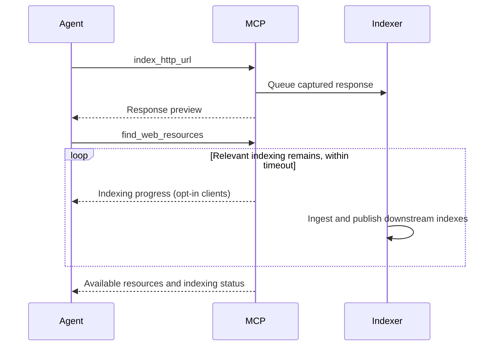
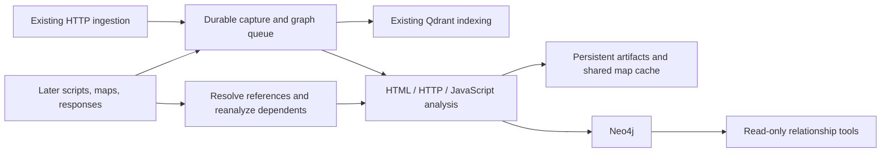
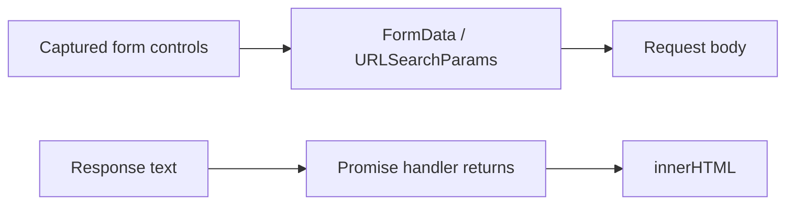

# shyhurricane


ShyHurricane is an MCP server to assist AI in offensive security testing of web applications. It aims to solve a few problems observed with
LLMs:

1. Spidering and directory busting commands can be quite noisy and long-running. LLMs will go through a few iterations to pick a suitable command and options. The server provides spidering and busting tools to consistently provide the LLM with usable results.
2. Models will also enumerate websites with many curl commands. The server saves and indexes responses to return data without contacting the website repeatedly. Large sites, common with bug bounty programs, are not efficiently enumerated with individual curl commands. 
3. Port scans may take a long time causing the LLM to assume the scan has failed and issue a repeated scan. The port_scan tool provided by the server addresses this.

An important feature of the server is the indexing of website content using embedding models. The `find_web_resources` tool uses LLM prompts to find vulnerabilities specific to content type: html, javascript, css, xml, HTTP headers. The content is indexed when found by the tools. Content may also be indexed by feeding external data into the `/index` endpoint. Formats supported are `katana jsonl`, `hal json` and Burp Suite Logger++ CSV. The `ingest.py` script also converts Burp Suite request/response XML exports for indexing. Extensions exist for Burp Suite, ZAP, Firefox and Chrome to send requests to the server as the site is browsed.

## Assessment prompts

MCP clients can discover these reusable workflows with `prompts/list` and render them with
`prompts/get`. Rendering produces assessment instructions without running tools or contacting targets.

| Prompt | Purpose |
|--------|---------|
| `map_attack_surface` | Inventory captured endpoints, forms, scripts, services, and assessment opportunities |
| `hunt_vulnerability` | Investigate the supplied `vulnerability_type` using captured content and graph evidence |
| `hunt_xss` | Review reflected, stored, and DOM XSS candidates and source-to-sink paths |
| `hunt_access_control` | Investigate IDOR/BOLA, privileged operations, and authorization boundaries |
| `hunt_injection` | Review SQL, NoSQL, command, and template injection indicators |
| `hunt_ssrf` | Investigate URL-consuming features and possible server-side request boundaries |
| `review_authentication_sessions` | Review login, recovery, OAuth, JWTs, cookies, and session lifecycle |
| `review_configuration_exposure` | Review secrets, sensitive resources, debug interfaces, CORS, and headers |
| `trace_input_to_sink` | Trace graph sources and sinks and inspect supporting evidence |
| `find_vulnerability_chains` | Correlate findings, graph flows, and possible journeys into evidence-supported chains |

| Argument | Required | Meaning |
|----------|----------|---------|
| `target` | Yes, all prompts | Host, domain, IP, netloc such as `app.example.com:8443`, or HTTP(S) URL prefix |
| `mode` | No | `analysis` (default) uses captured evidence; `active` also guides scoped live reconnaissance and validation |
| `vulnerability_type` | Yes, `hunt_vulnerability` only | Free-text vulnerability class or classes to investigate |

Use bracketed IPv6 targets, such as `[2001:db8::1]:8443`. Hostname scopes include subdomains;
explicit ports are retained, and URL prefixes restrict scheme, host, and path. User-supplied narrower
scope still applies. Query strings, fragments, credentials in target URLs, and malformed targets
are rejected.

For example, send `prompts/get` with these parameters:

```json
{"name":"hunt_vulnerability","arguments":{"target":"app.example.com:8443","vulnerability_type":"IDOR"}}
```

For graph-assisted chain analysis with scoped live testing guidance:

```json
{"name":"find_vulnerability_chains","arguments":{"target":"example.com","mode":"active"}}
```

Workflows begin with existing findings and indexed evidence. Analysis mode declines scan confirmations
and makes no target requests. Active mode respects existing confirmations and authorization, uses
available open-world tools, and describes manual checks where those tools cannot perform validation.
Prompts remain available with `OPEN_WORLD=false`; active workflows then continue indexed analysis
and report the limitation. Low-power workflows use predicate-only retrieval and captured content.

All assessment prompts use an endpoint-first graph workflow: overview, focused candidates,
traces, then step evidence. They request full graph details only when needed, distinguish bounded
examples from complete results, and keep navigation hypotheses separate from data-flow evidence.

Graph paths are investigation candidates, not proof of exploitation. Reports distinguish verified
steps, inferred links, missing prerequisites, and analysis gaps. Workflows direct the client to save
new evidence-backed findings with verification status, avoid duplicates, and keep unsupported
hypotheses in the report. Rendering a prompt alone never saves findings.

## Tools

The following tools are provided:

| Tool                        | Description                                                                                         | Open World? |
|-----------------------------|-----------------------------------------------------------------------------------------------------|-------------|
| port_scan                   | Performs a port scan and service identification on the target(s), similar to the functions of nmap. | Yes         |
| spider_website              | Spider the website at the url and index the results for further analysis                            | Yes         |
| directory_buster            | Search a website for hidden directories and files.                                                  | Yes         |
| index_http_url              | Index an HTTP URL to allow for further analysis. (aka curl)                                         | Yes         |
| find_wordlists              | Find available word lists for spidering and directory_buster                                        | No          |
| find_web_resources          | Query indexed resources about a website using natural language .                                    | No          |
| fetch_web_resource_content  | Fetch the content of a web resource that has already been indexed.                                  | No          |
| find_domains                | Query indexed resources for a list of domains.                                                      | No          |
| find_hosts                  | Query indexed resources for a list of hosts for the given domain.                                   | No          |
| find_netloc                 | Query indexed resources for a list of network locations, i.e. host:port, for a given domain.        | No          |
| find_urls                   | Query indexed resources for a list of URLs for the given host or domain.                            | No          |
| register_hostname_address   | Registers a hostname with an IP address.                                                            | No          |
| register_http_headers       | Register HTTP headers that should be sent on every request.                                         | No          |
| save_finding                | Save findings as a markdown.                                                                        | No          |
| query_findings              | Query for previous findings for a target.                                                           | No          |
| deobfuscate_javascript      | De-obfuscate JavaScript content (automatically done during indexing)                                | No          |
| get_result_page             | Retrieve a saved page using an opaque navigation token.                                             | No          |

### Result limits and saved pages

List tools return a first page and optional `pagination` metadata. Use
`get_result_page(page_token)` with `pagination.next_page_token` or
`pagination.previous_page_token` to navigate the same saved result without repeating a query or scan.
The paging tool returns `{ "source_tool": "...", "result": { ... } }`; `result` uses the producing
tool's response schema. Tokens are opaque bearer capabilities: anyone holding a token can read its
saved page through this server. Keep tokens private.

| Tool                                        | Default page size   | Saved result                                               |
|---------------------------------------------|---------------------|------------------------------------------------------------|
| `find_web_resources`                        | 20 resources        | Up to `retrieval_limit` matches (default 1,000)            |
| `query_findings`                            | 10 full findings    | All matching findings                                      |
| `find_urls`                                 | 100 URLs            | All matching unique URLs                                   |
| `find_wordlists`                            | 20 paths            | All matching ranked paths                                  |
| `find_domains`, `find_hosts`, `find_netloc` | 100 records         | All matching unique records                                |
| `spider_website`                            | 50 resources        | Results collected before this call returns                 |
| `directory_buster`                          | 100 URLs            | Results collected before this call returns                 |
| `port_scan`                                 | 100 service records | Available structured scan results                          |
| `index_http_url`                            | 16,384 characters   | Complete textual response, after JavaScript transformation |
| `deobfuscate_javascript`                    | 8,192 characters    | Complete transformed script, or original script on failure |
| `fetch_web_resource_content`                | 4,096 characters    | Existing offset-based retrieval                            |

List `limit` arguments control page size and accept 1–1,000. `find_web_resources` separately accepts
`retrieval_limit` from 1–1,000; `pagination.retrieval_truncated` reports when additional matches were
excluded by that cap. Narrow the query to retrieve other matches. Cached spider responses similarly
save at most 1,000 resources. Results preserve their original ordering throughout navigation.
Counts limit records, not total serialized bytes; full findings and headers can still be large.

`pagination` includes one-based `page_number`, `page_size`, `total_items`, `total_pages`, `expires_at`,
`next_page_token`, `previous_page_token`, and `retrieval_truncated`. Text totals and limits count
Unicode characters. First pages have no previous token and last pages have no next token. Empty
results have no snapshot and `pagination` is null. Nonempty single-page results are saved with both
navigation tokens null.

For example, call `find_urls` with:

```json
{"host_query": "example.com", "limit": 10}
```

Then pass the returned `pagination.next_page_token` to:

```json
{"page_token": "<opaque token from the response>"}
```

`scan_complete` describes scan completion, independently of saved-page navigation.
A page token accesses only results available when that snapshot was created. Scanning and indexing
continue after a tool's wait timeout; later scan calls create separate snapshots. Use indexed search
for discoveries made after the original call returned.

`port_scan` returns structured `results` instead of embedding XML (`nmap_xml` is null).
Its `nmap_xml_page_token` retrieves the first saved XML fragment through `get_result_page`.
Follow navigation tokens and concatenate the `result.text` fragments in order to reconstruct the
complete XML; individual fragments need not be valid XML documents. XML fragments are 8,192 characters.

`deobfuscate_javascript` returns an object with `text`, `mime_type`, `offset`, `total_length`,
`pagination`, and `transformation_status`. `find_wordlists` returns `paths` and `pagination`.
`index_http_url.content_length_limit` controls preview characters, default 16,384, and no longer
omits large bodies or limits indexing. All textual response bodies are submitted for indexing,
including responses without `Content-Length`. Preview limits apply after JavaScript transformation.
Binary responses return metadata only. `deobfuscate_javascript.output_length_limit` defaults to 8,192.
Both preview overrides accept 1–4,194,304 characters. `fetch_web_resource_content` retains
`output_start_position`, `output_length_limit`, and its offset-based partial-content fields, including `contents.has_more`.

`index_http_url` treats a missing or empty response `Content-Type` as unknown and includes the decoded body.
It accepts HTTP and HTTPS URLs; invalid URLs and request inputs raise explicit tool errors, as does
disabled open-world access. Connection failures, timeouts, protocol failures, and excessive redirects
return null. HTTP 4xx/5xx responses are still indexed. Redirects are not followed by default; enable
`follow_redirects` only when destinations are in scope.
If JavaScript transformation encounters a filesystem or subprocess failure, the preview retains the
original response text. Queue failures report that fetching succeeded but queueing failed.
Preview storage failures report that ingestion was already queued; repeating the call may enqueue
the same response again. These stages do not automatically retry.

`deobfuscate_javascript.transformation_status` is `empty` for blank input, `succeeded` when
the transformation command succeeds, and `failed` when it fails and returns the original input.
Success does not guarantee complete source recovery. The status is preserved on saved pages.
Older saved results without a status report `unknown`.
Indexed JavaScript has already undergone automatic transformation; repeat it only when warranted.

For `fetch_web_resource_content`, when `contents.has_more` is true, request the next chunk with
`output_start_position = contents.offset + len(contents.text)`. This tool uses character offsets
rather than saved-page tokens. It reads indexed content without contacting the target.

Pending scans can return no resources while `scan_complete=false`; this does not establish that
the target is unreachable. Avoid starting duplicate scans. `port_scan.retry` is deprecated and
ignored; repeated calls with the same parameters retrieve cached or pending results, without a
forced rescan. Indexing is asynchronous; retrieval tools wait briefly for relevant queued work and report when
results may still be incomplete.

Findings returned by `query_findings` may be unverified or outdated. Review their evidence before
treating them as confirmed vulnerabilities. New findings should include
evidence and verification status, with unavailable details marked explicitly. `save_finding`
acknowledges queuing for asynchronous persistence; immediate queries may not include the finding.

Saved pages live in `<server cache_path>/result_pages`, outside per-client working directories, and
survive session closure and server restarts. Expiration is fixed at creation; reading pages does not
extend it. Expired, missing, or corrupt results require repeating the original operation. Cleanup
runs before serving requests, at shutdown after workers drain, and before each new paginated query,
scan, or content operation. Unexpired snapshots remain on shutdown. No periodic background cleanup
runs while the server is idle. This store follows the server's single-process deployment model.

| Environment variable      | Default                        | Description                                                                                                                                   |
|---------------------------|--------------------------------|-----------------------------------------------------------------------------------------------------------------------------------------------|
| `TOOL_CACHE`              | Unset; uses `<data-dir>/tool_cache` | Compose compatibility override: parent of `tool_cache`; Compose retains its `/tool_cache` volume |
| `TOOL_RESULT_TTL_SECONDS` | `86400`                        | Positive integer retention in seconds for newly created snapshots; existing expiration times remain unchanged                                 |

For Docker Compose, set `TOOL_RESULT_TTL_SECONDS` in `.env` and restart the service. Both Compose
configurations retain saved pages in the existing `tool_cache` volume.

### Waiting for indexing

Web-resource search, content fetch, domain/host/netloc/URL inventories, and application-graph tools
wait up to 60 seconds for indexing relevant to their query before reading available data. Indexing
and scan tools still return promptly after queueing work. Unrelated targets do not delay scoped
queries; an unfiltered inventory considers all targets. Finding queries, direct MCP resource reads,
and saved-page navigation do not wait.

| Environment variable | Default | Description |
|----------------------|---------|-------------|
| `INDEXING_WAIT_TIMEOUT_SECONDS` | `60` | Finite, nonnegative seconds to wait for relevant indexing per retrieval call; `0` disables waiting |

`--indexing-wait-timeout-seconds` overrides the environment. Both Compose configurations accept the
variable from `.env`; restart the service after changing it. The timeout covers the indexing wait,
including nested lookups, separately from the normal query's execution time.



Progress notifications describe elapsed time and pending/processing counts immediately upon waiting,
every five seconds during the wait, and when the wait ends. Clients must opt into MCP progress to
receive them. Cancellation stops the wait without cancelling indexing.

Covered results include `indexing.status`, `waited_seconds`, `potentially_incomplete`, per-stage
`stages` counts (`pending`, `processing`, `failed`), and `skipped_stages`. Status is `complete`,
`timed_out`, `paused`, `failed`, `unavailable`, or `disabled`. Only `complete` establishes that no
relevant outstanding or failed indexing work was observed; it does not guarantee exhaustive analysis.
A timeout returns currently available data and does not stop workers. Failed items do not prolong
the wait. Unresolvable queue metadata or status-read errors report `unavailable`, rather than success.

Content fetch retains its content fields and adds `indexing`. If no content is available while
indexing is incomplete, it returns only `{ "indexing": { ... } }`; a confirmed miss remains `null`.
With waiting disabled, missing content retains the previous `null` behavior. Graph evidence retrieval
similarly returns a status-only object when evidence is missing and indexing is incomplete. Saved
pages preserve the original indexing status and never wait again.

Semantic search and explicit type filters such as `type:javascript` also wait for type-specific
indexing. Low-power mode skips deliberately paused type-specific indexing and reports outstanding skipped work
as `paused`; ingest and graph stages still wait normally. Graph waits include known script and
source-map dependencies of scoped documents, including dependencies on other origins. Opaque content
URIs use their indexed URL when available; if a missing URI cannot be related to outstanding ingest,
status is `unavailable`. Scope metadata is backfilled for active and failed legacy queue records
before workers start; queue payloads and records are preserved.

New relevant indexing arriving during a wait is included, so continuous ingestion for the same scope
may consume the full timeout. A completed wait does not wait for scans to discover future resources.
Do not start duplicate scans because an indexing wait timed out.

### Search predicates

`find_web_resources` accepts hard filters alongside natural-language queries. Predicates apply before semantic
ranking and are combined with AND, including repeated predicates. Prefix a predicate with `-` to exclude matches;
quote values containing spaces. Content and title analysis remains part of the natural-language query.

| Predicate           | Meaning                                                                                                      | Example                                                                      |
|---------------------|--------------------------------------------------------------------------------------------------------------|------------------------------------------------------------------------------|
| `site:`             | Hostname and its subdomains, or an exact IP; optionally restrict port, scheme, and URL path prefix           | `site:example.com`, `site:example.com:8443`, `site:https://example.com/app/` |
| `inurl:`            | Case-sensitive literal substring anywhere in the URL, including the query string                             | `inurl:admin`, `-inurl:"logout page"`                                        |
| `filetype:`, `ext:` | Case-insensitive final path extension; ignores query strings and fragments                                   | `filetype:js`                                                                |
| `mime:`             | Exact response MIME type, ignoring case and parameters                                                       | `mime:application/json`                                                      |
| `method:`           | HTTP request method, ignoring case; intersects with the `http_methods` argument                              | `method:POST`                                                                |
| `status:`           | Exact HTTP response status code from 100 to 599                                                              | `status:403`                                                                 |
| `type:`             | Indexed representation: `html`, `javascript`, `css`, `xml`, `json`, `network`, `forms`, `content`, `default` | `type:network`                                                               |

Examples:

```text
site:example.com filetype:js -inurl:vendor potential unsafe eval calls
site:example.com status:403 method:GET
site:example.com mime:application/json -inurl:logout
site:[::1]:8080 type:network
```

Positive `site:` predicates supply the target and take precedence over target inference. A hostname scope includes
all indexed ports unless a port is specified. A URL scope additionally restricts scheme and path prefix.
Other explicit predicates override inferred constraints for the same attribute. Conflicting filters return no matches.
Exclusions alone do not supply a target; existing target selection and confirmation behavior still applies.

Queries containing only predicates retrieve indexed results without LLM calls and work in low-power mode.
Queries with remaining natural-language text use semantic retrieval and require normal power mode.
These are Google-style conveniences with the semantics above; Boolean expressions, date and technology predicates,
`intitle:`, and `intext:` are not parsed as hard filters. Unrecognized syntax remains in the natural-language query.
Filtering uses existing indexed metadata without a migration; broad URL filtering can require a metadata scan.
When a target has indexed documents but nothing matches, the tool suggests broadening the query or relaxing filters.
Index-population guidance is reserved for targets with no indexed documents.

## Application Relationship Graph

Neo4j stores an incremental graph of captured web application resources, forms, fields, scripts,
routes, and possible data flows. Graph processing uses the existing ingestion inputs. It does not
crawl links or fetch imports, API endpoints, manifests, or other discovered resources. JavaScript
scanning and graph analysis share source-map fetching and transformation caches: the existing
`.js.map` fetch remains permitted when `OPEN_WORLD=true`. With `OPEN_WORLD=false`, only supplied
maps are used. Inline maps and explicitly referenced maps already present in ingestion are supported.



Capture events are saved before vector-store normalization and deduplication. Repeated ingestion and
worker retries use deterministic identities. The graph retains response versions and evidence;
arrival order does not determine which version is latest. A dedicated worker activates each complete
capture atomically and reconciles references when their targets arrive later. Transient database failures
retain queued work; permanently failed analyses remain visible in monitoring.
Publication stages an immutable analysis generation using independent transactions of at most
500 records and approximately 4 MiB of serialized payload. Entities, evidence, relationships,
module/DOM links, and cleanup all use bounded transactions. A small final transaction activates the
complete generation; queries continue to see the previous successful analysis during reanalysis,
interruptions, and failures. Element IDs remain stable; evidence IDs identify immutable publication
evidence. Staged results are excluded from graph tools and statistics.
Progress logs identify committed batches, record counts, payload sizes, activation, and memory
budget failures. Transaction-memory errors subdivide the affected batch down to one record. If a
single record still cannot fit, the capture is recorded as a failed analysis and other work continues;
the prior complete graph remains available. Analyzer failures and timeouts remain analysis gaps.
Consuming-document context URL lists are stored on capture/publication metadata and resolved by graph queries,
avoiding repeated large properties on each JavaScript node and evidence record. Existing graph
records remain readable and adopt publication generations when reprocessed.
Committed staging batches can be replayed after a crash; acknowledgement loss after activation does
not republish the same generation. Superseded entities and relationships become eligible for bounded
cleanup after five minutes. Cleanup runs during health checks and after publication, resumes after
restart, and cannot invalidate an active graph. Published evidence and its context metadata are
retained, including evidence referenced by earlier saved result pages. Abandoned staging evidence
is reclaimed with its staged graph.

New reanalysis requests are coalesced by capture ID in a durable scheduler. Repeated requests
share one pending task; updates received during processing produce at most one follow-up task.
Different capture versions remain separate. Delivery tickets and persisted traversal budgets
preserve crash recovery and bound cycles to 32 captures per traversal. Existing queue entries
drain normally without compaction; only newly scheduled reanalysis uses coalescing. The dashboard
continues to show one count of queued and processing graph work. Graph producers do not reclaim
live tasks; the single graph worker performs recovery on startup. Scheduler state is added
automatically to the existing artifact SQLite database; no backfill rerun is required.

### Graph tools

All graph tools are read-only, require an explicit scope, work in low-power mode, and never make
target requests. Scope accepts a hostname, `host:port`, or HTTP(S) URL prefix. Hostname scopes include
subdomains on hostname boundaries; URL scopes restrict scheme, host, and path prefix.

| Tool | Purpose |
|------|---------|
| `find_application_endpoints` | Start with URL/method summaries, captured/referenced status, inputs, scripts, and flow candidates |
| `find_application_elements` | Discover resources, elements, fields, source reads, and sink operations; filter by `kinds`, `role`, or exact `url` |
| `find_application_relationships` | Inspect incoming or outgoing relationships around a returned element ID |
| `trace_application_data_flow` | Follow possible data flow forward to sinks or backward to sources |
| `find_user_journey_paths` | Find possible navigation, form-submission, and redirect paths between exact URLs or resource IDs |
| `fetch_application_graph_evidence` | Read the evidence, capture identity, source location, and inference rule behind a path step |

#### Graph tool arguments

Types below are JSON types. Optional arguments accept their documented defaults; nullable filters
also accept `null`. IDs are opaque strings: copy them unchanged from the indicated response field.
All graph string arguments, including each `kinds` entry, ignore leading and trailing whitespace.
Case, internal whitespace, and URL escaping remain unchanged. Blank strings are not converted to `null`;
use `null` to omit a nullable filter.
Use the same application scope when passing IDs between tools.
Begin with `find_application_endpoints`, optionally narrowing to an exact `url` and HTTP `method`.
Each entry identifies one resource ID, URL, and method, including assets. `capture_status` is
`captured` when an observed capture is in the selected snapshot, otherwise `referenced`; this does
not mean the resource has never been captured. Inputs/forms, scripts, sources, and sinks each have
`count`, at most three `examples`, `examples_limited`, and a list of concrete `follow_up` tool calls.
Counts describe graph elements in the bounded snapshot, not unique business inputs or a complete
application inventory. `association` distinguishes directly related nodes from script-context
candidates; a related script does not prove that an endpoint input reaches its sinks.

Element discovery applies `context_url` and `role` filters in Neo4j before selecting and hydrating
its bounded snapshot. Context matching includes direct URL matches and consuming-document contexts
for external scripts. Unexpected graph query failures log the original exception and traceback;
clients receive the existing generic error. Startup automatically adds an index on publication
capture IDs for legacy context lookups.

Element discovery prioritizes resources, then fields/HTML elements, then code artifacts when
`kinds` is omitted. All four existing graph list tools now default to `detail="compact"`: nodes
retain IDs, kinds, names, roles, URLs, methods, and source locations; steps retain IDs, kinds,
source/target IDs, classifications, and evidence IDs. Use `detail="full"` for the previous public
properties, including context lists and module details. Filtering and path membership are identical.
IDs on saved pages have the same meaning as IDs on the first page (`get_result_page` wraps the producing response in `result`).

| Argument | Tools | Type / default | Purpose and values |
|----------|-------|----------------|--------------------|
| `method` | `find_application_endpoints` | string or null; default null | Exact HTTP method filter, ignoring case; e.g. `GET` or `POST` |
| `detail` | Elements, relationships, data flow, journeys | string; default `compact` | `compact` keeps essential identity and evidence fields; `full` returns all public properties |
| `context_url` | `find_application_elements` | string or null; default null | Exact page URL matched against an element’s own URL or its consuming-document contexts, including external scripts |
| `scope` | All graph tools | string, required | Hostname, `host:port`, or HTTP(S) URL prefix; restricts the application evidence queried |
| `kinds` | `find_application_elements` | array of strings or null; default null | Match any case-sensitive element kind, e.g. `resource`, `element`, `field`, `cookie`, `origin`; discover other values in `results[].kind`. Omitted, null, or `[]` applies no kind filter |
| `kinds` | `find_application_relationships` | array of strings or null; default null | Match any case-sensitive relationship kind, e.g. `CONTAINS`, `LOADS`, `NAVIGATES_TO`, `SUBMITS_TO`, `FLOWS_TO`; discover values in `results[].steps[].kind`. Omitted, null, or `[]` applies no kind filter |
| `role` | `find_application_elements` | string or null; default null | `source` reads input; `sink` consumes data. Null includes all roles. These static classifications are investigation candidates |
| `url` | `find_application_elements`, `find_application_endpoints` | string or null; default null | Exact element resource URL filter, rather than a prefix or text search; null applies no URL filter |
| `element_id` | `find_application_relationships` | string, required | Element ID from `find_application_elements.results[].id`, resource ID from `find_application_endpoints.results[].id`, or exact resource URL |
| `start` | `trace_application_data_flow` | string, required | Element ID from `find_application_elements.results[].id`, resource ID from `find_application_endpoints.results[].id`, or exact resource URL; resource starts select associated sources forward or sinks backward |
| `end` | `trace_application_data_flow` | string or null; default null | Element ID, resource ID, or exact resource URL; resource destinations select sinks forward or sources backward. Null seeks sinks forward or sources backward |
| `start`, `end` | `find_user_journey_paths` | strings, both required | Starting and destination exact captured resource URLs, or resource IDs from `find_application_endpoints.results[].id` or `find_application_elements.results[].id` queried with `kinds=["resource"]` |
| `direction` | Relationships and data flow | string; default `forward` | `forward` follows outgoing relationships; `backward` follows incoming relationships |
| `max_depth` | `find_application_relationships` | integer; default 1 | Maximum relationship steps, 1–3 |
| `max_depth` | Data flow and journeys | integer; default 8 | Maximum relationship steps, 1–32 |
| `historical` | All except evidence retrieval | boolean; default false | Include all retained capture versions when true; false selects latest versions |
| `as_of` | All except evidence retrieval | number or null; default null | Capture-time cutoff in Unix seconds, not milliseconds. With `historical=false`, selects latest captures at or before the cutoff; null applies no cutoff |
| `limit` | All except evidence retrieval | integer; default 5 for endpoints, 20 otherwise | Results per saved page, 1–1,000; follow `pagination.next_page_token` with `get_result_page` |
| `evidence_id` | `fetch_application_graph_evidence` | string, required | Copy `results[].steps[].evidence_id` from `find_application_relationships`, `trace_application_data_flow`, or `find_user_journey_paths` |

For example, call `find_application_endpoints` for a known URL:

```json
{"scope":"example.com","url":"https://example.com/blog","method":"GET"}
```

Follow its suggested calls, or discover page-associated sources with `find_application_elements`:

```json
{"scope":"example.com","context_url":"https://example.com/blog","role":"source"}
```

Pass a returned source ID to `trace_application_data_flow`, or start from the exact resource URL:

```json
{"scope":"example.com","start":"https://example.com/blog","direction":"forward","max_depth":8}
```

Resource URLs select all matching methods; use a resource ID to select one method. Flow responses
include `resolved_start_count`, `resolved_end_count`, and up to 20 IDs per side in
`resolved_start_ids` / `resolved_end_ids`; `seed_ids_limited` reports omitted ID examples.
Seed selection uses direct associations and exact script contexts, not a flow edge. The tool then
traverses only existing flow relationships; it does not add containment or script-loading edges.
Missing seeds and selected seeds with no discovered path are reported separately in `analysis_gaps`.

Pass a returned `results[].steps[].evidence_id` to `fetch_application_graph_evidence`:

```json
{"scope":"example.com","evidence_id":"<evidence ID from a trace step>"}
```

Source/sink labels describe static operations, including ordinary input handling and network
boundaries. They do not establish attacker control. Framework symbols and generic property reads
do not establish prototype pollution or template injection. Captured HTTP traffic cannot establish
backend database queries or filesystem execution. Investigate actual paths and supporting evidence.

Find possible journeys with `find_user_journey_paths`:

```json
{"scope":"example.com","start":"https://example.com/signup","end":"https://example.com/account"}
```

Queries select the latest observations by capture time. Set `historical=true` to include retained
versions, or `as_of` to a Unix capture timestamp to query a historical cutoff. Missing capture times
use ingestion time and are flagged. Results contain observed, declared, or statically inferred
relationships with evidence IDs. List tools use saved-result pagination, defaulting to five endpoint
summaries or 20 other items per page. Follow `pagination.next_page_token` using `get_result_page`.

Traversal defaults to eight steps, with a maximum of 32; relationship inspection allows up to three.
Queries cap exploration at 10,000 entities, 20,000 relationships, 1,000 results, and ten seconds per
database query/traversal. `retrieval_truncated` and `truncation_reasons` report reached limits; `analysis_gaps` reports missing
artifacts or incomplete analysis. Cross-origin request/navigation destinations are boundaries;
supplied scripts used by scoped documents remain available for dependency and flow analysis.
Queries first select a bounded set of relationship IDs, then hydrate immutable relationships,
entities, capture metadata, and shared context in windows of at most 500 relationships. Each window
loads its dependencies before the next window; shared entities and metadata are cached across windows.
Indexed ID-list lookups avoid per-ID query expansion. Every database request contains at most 500
input records. Startup waits for schema indexes to become available before serving hinted reads.
Hydration keeps its 120-second total budget, within the five-minute cleanup grace period. Each read
uses at most ten seconds or the remaining budget, without automatic transaction retries. If a budget
is reached, completed records remain available and results report applicable time, memory, and missing
generation limits. Repeat the query when a generation is unavailable.
DEBUG logs report stage, batch size, returned records, elapsed time, and remaining budget. A completion
summary reports selected/completed relationships, memory subdivisions, and incompleteness reasons;
incomplete hydration is logged at WARNING. See [hydration measurements](docs/graph_hydration.md).

Relationship, flow, and journey tools resolve indexed seeds and load bounded frontiers rather than
hydrating the entire application scope. Flow seed association includes direct inputs and contextual
scripts; association edges do not become flow evidence, and unlabelled intermediates remain traversable.
External destinations can be returned as boundary nodes but are not expanded beyond scope.
The 20,000-membership budget counts distinct relationships loaded for seed associations and traversal;
unrelated graph regions no longer displace focused paths. Shared dependencies and adjacency are cached
per request, with a shared 120-second database-work deadline, ten-second read caps, and a separate
ten-second traversal CPU budget. No-path diagnostics describe the explored graph rather than claiming
application-wide absence of sources or sinks.

Each traversal reads a publication revision once. Activation atomically stamps publication and
retirement revisions, so reanalysis between frontier reads cannot mix generations. Existing active
publications are revision zero; older retired publications remain excluded, and legacy archives remain
readable. Startup initializes the revision counter and logical-ID index without a bulk data backfill.
**Upgrade with all older server processes stopped:** mixed-version writers do not maintain the revision
protocol. Keep the existing single-server deployment model. MCP arguments and saved-page schemas are
unchanged. DEBUG logs report frontier depth, batch/read counts, and cache sizes; completion logs report
path count, loaded memberships, elapsed time, and limiting reasons.

### Inference coverage and limits

HTML analysis extracts links, forms, submission overrides, fields, base URLs, frames, inline scripts,
event handlers, import maps, resource dependencies, and refresh navigation. HTTP analysis uses
redirects, Referer, Origin, Fetch Metadata, request parameter names, and typed Link headers.
Origin-only Referer values and subresource requests do not establish a navigation step. Supplied CSS,
web manifests, OpenAPI documents, and Vite build manifests contribute explicit relationships.

The JavaScript analyzer parses delivered or source-map-recovered JavaScript, JSX, TypeScript, and
TSX without evaluating the application. It follows lexical bindings, assignments, expressions,
parameters, returns, calls, callbacks, and imports/exports. It recognizes common browser sources and
sinks, fetch/XHR, Axios/Angular HTTP calls, storage access, navigation, workers, and messaging.
Explicit imported function argument/return interfaces link across ingested modules. Processing is
bounded to 40 MiB per source artifact, 10,000 semantic nodes and 20,000 edges per script, and 240
seconds per analyzer container, with a 3 GiB container memory limit.

Framework models cover React/Next.js links, forms, state and HTML sinks; Vue/Nuxt bindings, navigation
and HTTP helpers; Angular delivered templates, forms, routing and HttpClient; and Svelte/SvelteKit
bindings, links, forms and navigation. Vite support includes native modules, generated lazy/glob
imports, and supplied build-manifest chunk/CSS/asset dependencies. An unexpanded glob cannot reveal
files that were not supplied. Recovered source-map paths are virtual identifiers, not fetchable URLs
or filesystem destinations.

This is bounded, conservative static analysis. Dynamic dispatch, runtime-generated URLs, aliases
without explicit mappings, framework transformations, missing modules, and backend implementation
can leave gaps. Source/sink classifications and paths are candidates for investigation, not confirmed
vulnerabilities. Recognized transformations do not prove sanitization. Captures do not identify browser
sessions, so journey paths are possibilities rather than recorded user sessions. Session storage is
not joined across unrelated captures. Historical paths can span observations at different times.

### Library summaries and graph size estimates

By default, exact verified copies of AngularJS 1.7.7, React development, and React DOM development
are summarized. Recognition uses the entire response's SHA-256 hash, independently of its filename.
Modified distributions, other versions, application code, and mixed bundles retain full analysis.
The initial registry covers the three distributions observed during graph-size investigation; it is
intentionally conservative. Set `GRAPH_LIBRARY_ANALYSIS=full` to disable library summarization.

Summaries retain security sources/sinks, import/export and DOM boundaries, resource references,
and original directed flow paths of up to 16 edges. Selection is deterministic and bounded to 500
entities and 1,000 relationships per script when published, within the capture's overall limits.
Internal analysis permits 50,000 nodes and 100,000 edges for recognized libraries before selecting
summary paths, with at most 100,000 traversal steps. Gaps and `analysis_summaries` describe omitted
internals and reached budgets; an absent path does not establish safety. Original captures remain
available, and full analysis can be requested with the rebuild command.

Monitor counts marked `≈` are publication estimates, not unique graph record counts. **Current graph**
sums the latest completed captures per resource; **retained history** sums all completed captures.
Shared resources and other logical entities can be counted once per capture. Relationships whose
external endpoints were subsequently replaced may be overcounted. Network documents are a separate
vector-store representation and need not match the number of graph captures.

Counts are computed during publication and read from capture metadata, without entity/relationship
scans. The shared status service caches estimates for 60 seconds and refreshes in the background.
It shows unavailable or stale values if needed, and reports partial coverage for older captures
without count summaries. Existing API fields `entities` and `relationships` alias the approximate
retained-history counts; `current` and `retained_history` expose `entity_estimate`,
`relationship_estimate`, capture/resource counts, and coverage. Status also includes refresh time
and age. Empty graphs report zero; wholly uncovered graphs report unavailable estimates.

### JavaScript data-flow coverage

The analyzer separates call arguments from return values and models Promise fulfillment and rejection
independently. Supported patterns include expression-bodied arrows, lexical callback aliases, nested
`then` chains, `catch`, `finally`, `Promise.resolve`/`reject`, and `async`/`await`. Constant returns stop
incoming value propagation. Conditional tests do not create implicit data-flow edges.

Fetch response readers and properties on recognized XMLHttpRequest instances are external sources.
Request bodies remain separate from response values: a captured request never proves server reflection.
For example, the form-submission pattern has two independent paths:



Literal form selectors bind `FormData(form)`, regular submit-handler `this`, and
`event.currentTarget` to controls in the captured consuming document. Named `FormData.get`/`getAll`
reads select the requested field. Disabled, unnamed, unchecked, and non-data controls are excluded.
Form action and method can resolve a fetch destination when both trace to the same captured form.
Use literal ID selectors or `form[name="..."]` for form ownership; computed selectors remain unresolved.

Module argument/return interfaces support named/default imports, namespace member calls, lexical
aliases, and explicit named re-exports. Re-export chains are bounded to 32 links and retain supporting
evidence and capture-version constraints. Shared globals, computed dispatch, missing modules, and
unknown calls remain conservative summaries or explicit analysis gaps. General heap analysis,
call-site sensitivity, implicit control flows, and backend execution are not modeled.

An empty trace distinguishes missing seeds, missing source/sink operations, disconnected edges,
requested scope boundaries, and reached traversal limits through `analysis_gaps` and truncation
metadata. No result establishes safety. Broaden scope only when authorized, and inspect step evidence.
The analyzer policy version is now 3; existing captures require an explicit rebuild to gain these links.

Rebuild retained captures explicitly after updating the analyzer image and restarting the service:

```shell
uv run python -m shyhurricane.graph.rebuild \
  --data-dir assessment --target example.com --dry-run
uv run python -m shyhurricane.graph.rebuild \
  --data-dir assessment --target example.com --mode summary
```

Omit `--target` to rebuild all retained captures, or use `--mode full` for detailed library analysis.
Rebuilds use retained artifacts without fetching source maps, durably record the requested per-capture
policy, and require the graph worker to be running to consume queued work. That policy also applies
when those captures are reconciled later. Repeating a command skips pending or successfully completed
work for the current analyzer version and policy; failed work can be queued again. The old publication
remains queryable until replacement succeeds, and existing bounded cleanup reclaims retired records.
Rebuilding also populates missing count summaries. Startup never rebuilds or counts graph records.

### Neo4j operation and storage

Neo4j is required. Source runs create, start, or reuse a managed container, binding Bolt to an
available loopback port and mounting the configured host directory at `/data`, with persistent logs.
The default directory is `<data-dir>/graph`. Shutdown retains the container and data.
Both Compose configurations supply a private `graph` service with `neo4j-data` and `neo4j-logs`
volumes. No graph ports are published by Compose. Managed private deployments use the same
unauthenticated connection model as Qdrant; external servers can use credentials.

| Environment variable | Default | Description |
|----------------------|---------|-------------|
| `GRAPH_LIBRARY_ANALYSIS` | `summary` | `summary` retains bounded security paths for verified standalone library distributions; `full` retains ordinary detailed analysis. Unknown or modified scripts always use full analysis |
| `NEO4J` | Unset; `bolt://graph:7687` in Compose | External Bolt/Neo4j server URI; managed local storage uses `<data-dir>/graph` |
| `NEO4J_USERNAME` | `neo4j` | Username when `NEO4J_PASSWORD` is supplied |
| `NEO4J_PASSWORD` | Unset | Password for authenticated connections; also initializes authentication on a newly created managed container |
| `NEO4J_HEAP_SIZE` | `1g` | Initial and maximum JVM heap for newly created managed containers and the Compose graph service |
| `NEO4J_PAGECACHE_SIZE` | `256m` | Neo4j page-cache allocation for managed containers and the Compose graph service |
| `NEO4J_TRANSACTION_MEMORY_LIMIT` | Unset; Neo4j defaults to 70% of maximum heap | Optional combined transaction-memory budget for managed containers and the Compose graph service; must not exceed heap size |

Memory overrides accept positive integer sizes with `k`, `m`, or `g` suffixes, ignoring case.
They do not configure externally supplied Neo4j servers. A transaction-memory-limit error can occur
while Docker reports low overall memory use because Neo4j enforces its own transaction budget.
Heap and page cache also require headroom for native JVM memory and other services.

Set the memory variables in `.env` for Compose and recreate only the graph service:

```shell
docker compose up -d --force-recreate graph
```

Existing managed containers are reused without changing their memory settings. Startup warns when
their settings differ. To apply overrides, stop ShyHurricane, identify its exact managed container
name in the warning, then remove that container without removing its bind-mounted data directory:

```shell
docker stop <managed-container-name>
docker rm <managed-container-name>
NEO4J_HEAP_SIZE=1g uv run python mcp_service.py
```

The next startup recreates the container using the existing data and log mounts. No graph backfill
is required. Do not remove the graph directory or Compose volumes when applying memory settings.
After upgrading, already queued captures retry through bounded publication; captures explicitly
failed for an exhausted single-record budget require resubmission or a new reanalysis request.

Ingest, type-specific indexing, and graph workers pause while Neo4j is unhealthy, alongside existing
dependency checks. `/index` continues accepting durable queued work. Workers resume automatically.
The terminal dashboard and `/status` expose graph health, counts, queued work, failed analyses, and
unresolved references. Graph-statistics failures do not prevent other status reporting.

Original captures, transformation caches, reference indexes, and graph queues persist in the existing
per-database state directory (`/data/queues` in Compose). Graph artifacts and evidence have no automatic
expiration. Saved tool-result pages retain their existing expiration policy.

### Backfill existing indexed content

Run the server normally, then queue an offline backfill:

```shell
uv run python -m shyhurricane.graph.backfill --data-dir assessment
```

Use the same Qdrant database and persistent state location as the server. Backfill reads existing
content, network, and forms collections without target requests, including without map fetching.
It checkpoints submitted items and resumes on the next invocation. Existing normalized documents
cannot reconstruct missing request bodies, original markup, or discarded observations; resulting
evidence explicitly reports that limitation.

## Install

The MCP server itself uses an LLM for light tasks such that the `llama3.2:3b` model is sufficient. Ollama is recommended but not required. OpenAI, Google AI, AWS Bedrock, and LiteLLM models are supported. Docker is required for tool specific commands such as spidering and directory busting.

### Docker Desktop or colima

Docker is required and the quality of the networking stack is important. Docker Desktop is acceptable. On macOS, Apple Virtualization networking has issues. Use `colima` with `qemu` virtualization for better results.

If you use Homebrew, `brew bundle` may be used for installation. Otherwise, use your operating system to install `colima`, `qemu`, `docker`, and `docker-compose`.

Start `colima` with a command such as the following:
```shell
colima start --runtime docker --cpu 4 --disk 50 -m 4 --vm-type qemu
```

### nmap

It is best to run `nmap` on the host. If not installed on the host, the docker container will be used.

### Docker Compose

#### As a Docker Service

Configure one desired provider and model in `.env`:

| Provider    | Model variable                                    | Credential and connection variables                                  |
|-------------|---------------------------------------------------|----------------------------------------------------------------------|
| Ollama      | `OLLAMA_MODEL=llama3.2:3b`                        | `OLLAMA_HOST=192.168.253.100:11434`                                  |
| Google AI   | `GEMINI_MODEL=gemini-2.5-pro`                     | `GEMINI_API_KEY` or `GOOGLE_API_KEY`                                 |
| OpenAI      | `OPENAI_MODEL=gpt-5-nano`                         | `OPENAI_API_KEY`                                                     |
| AWS Bedrock | `BEDROCK_MODEL=us.meta.llama3-2-3b-instruct-v1:0` | `AWS_ACCESS_KEY_ID`, `AWS_SECRET_ACCESS_KEY`                         |
| LiteLLM     | `LITELLM_MODEL=anthropic/claude-sonnet-4-6`       | `LITELLM_API_KEY`; optionally `LITELLM_API_BASE` for a LiteLLM proxy |

For a direct LiteLLM provider connection, omit `LITELLM_API_KEY` and supply the selected provider's
standard credential environment variable, such as `ANTHROPIC_API_KEY`. When using Docker Compose, use
`LITELLM_API_KEY` and `LITELLM_API_BASE` to connect to a LiteLLM proxy.

Run the MCP server:

```shell
docker compose up -d
```

or to build the images from source:

```shell
docker compose -f docker-compose.dev.yml up -d
```

Add the MCP server to your client of choice at http://127.0.0.1:8000/mcp.

### MCP transports and elicitation

The server uses MCP Python SDK 2.2. Choose the transport with `--transport` or `MCP_TRANSPORT`.
An explicit command-line argument overrides the environment setting.

| Setting               | Default                                              | Description                                                              |
|-----------------------|------------------------------------------------------|--------------------------------------------------------------------------|
| `MCP_TRANSPORT`       | `streamable-http`                                    | `streamable-http`, `sse`, or `streamable-http-modern`                    |
| `DISABLE_ELICITATION` | `True` in Compose; enabled when unset in source runs | Set `False` to allow the client to ask for a target or scan confirmation |

| Transport                | Endpoint | Client state                                                                                 |
|--------------------------|----------|----------------------------------------------------------------------------------------------|
| `streamable-http`        | `/mcp`   | Legacy client sessions retain registered headers, hostname mappings, and working directories |
| `sse`                    | `/sse`   | Legacy SSE connections retain client state                                                   |
| `streamable-http-modern` | `/mcp`   | Stateless preset; every tool call starts with fresh client state                             |

Both HTTP presets accept legacy and modern protocol requests; the client's protocol version selects the workflow.
Modern clients use the 2026-07-28 protocol and have request-local state under either HTTP preset. Persistent
registration tools are unavailable to those clients. Supply `request_headers` and `additional_hosts` to each operation
that needs them. Working files are removed when the modern call finishes; legacy files last until the session closes.

Start the stateless preset from source:

```shell
uv run python mcp_service.py --transport streamable-http-modern
```

For Docker Compose, set `MCP_TRANSPORT=streamable-http-modern` in `.env` and restart the service. Use `.env.example`
as an example of transport and model settings.

Clients that support elicitation can supply missing target information and confirm scans. Legacy clients use a
callback; modern clients answer the SDK's multi-round input requests. If elicitation is disabled, unsupported,
declined, or cancelled, retrieval returns guidance without automatically starting a scan. Explicit scan tools
remain available when open-world access is enabled.

Search, spidering, and directory busting send status messages through MCP progress notifications.
These tools, port scanning, JavaScript deobfuscation, and URL indexing also send a progress notification
after 20 seconds without another progress update while a call is running. Informative updates reset
the idle deadline, and nested operations share one timer. Quick tools such as `find_wordlists` do not
send idle notifications. The interval depends on event-loop scheduling and transport availability.
Clients must request progress updates to receive these messages; server logging remains available.
Progress values count status events and do not estimate the total work.

Modern continuation tokens expire after ten minutes between rounds and are protected with a process-local key.
An interaction interrupted by a server restart must start again. Run one server process; legacy sessions require
requests to reach the process that created them. Streamable HTTP MCP request bodies have the SDK's 4 MiB limit;
the separate `/index` ingestion endpoint is unaffected.

### Run From Source

#### Python Environment

```shell
$(command -v python3.14) -m venv .venv
source .venv/bin/activate
uv sync
```

#### Application data directory

Use `--data-dir` or `DATA_DIR` to select the application storage root. The command-line option
wins over the environment variable. Absolute paths are used directly and `~` is expanded.
Relative paths are placed beneath the detected default, regardless of the working directory.
Paths that escape that default through `..` or symbolic links are rejected.

When `/data` exists as a directory, it is automatically the default. Otherwise, defaults are:

| Platform | Default data directory |
|----------|------------------------|
| Linux | `${XDG_STATE_HOME:-~/.local/state}/shyhurricane` |
| macOS | `~/Library/Application Support/shyhurricane` |
| Windows | `%LOCALAPPDATA%\shyhurricane`, falling back to `~/AppData/Local/shyhurricane` |

```shell
# Separate assessment beneath the detected default, shared by all three commands:
uv run python mcp_service.py --data-dir assessment
uv run python -m shyhurricane.graph.backfill --data-dir assessment
uv run python -m shyhurricane.graph.rebuild --data-dir assessment --dry-run

# Or choose an absolute directory:
uv run python mcp_service.py --data-dir /srv/shyhurricane
```

```text
<data-dir>/
  qdrant/                  Managed Qdrant storage
  graph/                   Managed Neo4j storage, including graph/logs/
  queues/<queue-name>/     Persistent ingest, document, finding, and graph queues
  graph_state/             Graph captures, artifacts, and maintenance checkpoints
  logs/                    Diagnostic, indexing, and finding logs
  certs/                   Replay proxy CA and certificates
  tool_cache/              Tool history, cached output, and result_pages/
  sessions/                Container working directories mounted at /work
```

| Environment variable | Default | Description |
|----------------------|---------|-------------|
| `DATA_DIR` | Detected default above | Application storage root; overridden by `--data-dir`; inherited as an absolute path by workers |
| `XDG_STATE_HOME` | `~/.local/state` | Linux state-directory base when `/data` is absent; relative values are ignored |
| `LOCALAPPDATA` | `~/AppData/Local` | Windows state-directory base when `/data` is absent |
| `QDRANT` | Unset; `db:6333` in Compose | External Qdrant `host:port`; managed local storage uses `<data-dir>/qdrant` |
| `MCP_SESSION_VOLUME` | Unset; `mcp_session` in Compose | Compose compatibility override for the Docker session volume; local runs bind `<data-dir>/sessions` |

`--database` and `--graph-database` have been removed from all commands. `QDRANT` and `NEO4J`
accept remote endpoints, not local storage paths. Existing data is not moved, copied, or deleted;
relocate it manually before starting against the new layout.

Docker Compose retains its existing named volumes and storage mappings, including separate
Qdrant, Neo4j, tool-cache, and session storage. Its remaining MCP state defaults to `/data`.
Compose is an exception to physical storage consolidation. External database storage, explicitly
selected diagnostic log files, model caches, and operating-system temporary files also retain
their existing locations.

#### File logging

Python logger messages at DEBUG and higher are appended to the UTF-8 file
`<data-dir>/logs/shyhurricane.log` by default. Set `LOG_FILE` or pass `--log-file` to override the
destination. The command-line option overrides the environment variable. Parent directories are created;
an unwritable destination stops startup with an error. Each record includes its timestamp, severity,
logger name, process name, and PID. Exceptions logged with exception details include their tracebacks.
The file remains active while the interactive dashboard suppresses console output, and worker
processes inherit the destination. Uvicorn access messages also reach the file during dashboard use.
Neo4j driver logging is limited to WARNING and higher to avoid formatting full graph parameter
payloads. Application graph progress and failure logs remain available.
Missing-property notifications from a new graph database are logged once per property per process;
repeated notifications are suppressed. Other Neo4j warnings and errors remain visible.

| Environment variable | Default                      | Description                                                              |
|----------------------|------------------------------|--------------------------------------------------------------------------|
| `LOG_FILE`           | `<data-dir>/logs/shyhurricane.log` | Diagnostic log path, relative to the working directory or absolute. |

```shell
uv run python mcp_service.py --log-file ./logs/server.log
# Or configure the destination through the environment:
LOG_FILE=./logs/server.log uv run python mcp_service.py
```

For Docker Compose, set `LOG_FILE=/tool_cache/logs/server.log` in `.env` and restart the service.
Both Compose configurations preserve that location in the existing `tool_cache` volume. Read it with:

```shell
docker compose exec mcp tail -n 200 /tool_cache/logs/server.log
```

The file uses append mode and has no automatic rotation. It records Python logging output;
raw subprocess stdout/stderr and exceptions handled without logging are not redirected into it.
The cache's `history.jsonl` remains a separate record of tool calls.

#### Ollama

Install Ollama and the `llama3.2:3b` model:

Ubuntu:

```shell
apt-get install ollama
ollama pull llama3.2:3b
```

macOS:

```shell
brew install ollama
brew services start ollama
ollama pull llama3.2:3b
```

#### Command Container Image

```shell
docker build -t ghcr.io/double16/shyhurricane_unix_command:main src/docker/unix_command
```

#### MCP Server

When started from an interactive terminal, the server displays a `shyhurricane` monitoring dashboard with
configuration, queue, database, indexing, and MCP tool information. It refreshes immediately
on startup and every 30 seconds afterward. Press `r` to refresh immediately. Press `q` to stop the
dashboard and shut down the server. Press `f` to mark failed items pending across the ingest,
type-specific indexing, scan-finding, and graph queues. The notification reports counts and any
per-queue errors; successful queues are committed even if another queue fails. Retrying preserves
payloads and leaves processing items untouched. Workers pick up pending work asynchronously and
may fail again if the original problem remains. Repeated key presses do not overlap retry operations.

The **MCP tools** panel lists running tools followed by the last five completed calls, newest first.
Yellow dots indicate running tools, green dots indicate completed calls, and red dots indicate
failures (including cancelled calls). History is kept in memory until the server restarts.

Queue status counts include pending and processing items. Each persistent queue row appends
`, N failed` only when its failed count is greater than zero. Scan findings have their own row.
Missing queue databases count as empty; read failures display unavailable. Database statistics always
shows `Findings: <count>` first,
using the primary Qdrant `finding` collection count, followed by the top five other collections.
After the dashboard closes, a log message reports that shutdown
is waiting up to five minutes for current operations to finish. Shutdown stops claiming new work and
allows current operations up to five minutes to finish before terminating remaining workers. Pending
persistent queue items remain available for the next startup. SIGINT and SIGTERM use the same shutdown behavior.
Non-interactive starts, including Docker Compose, continue to use normal logging output.

Ollama with `llama3.2:3b`:
```shell
python3 mcp_service.py
```

OpenAI:
```shell
export OPENAI_API_KEY=xxxx
python3 mcp_service.py --openai-model gpt-4-turbo
```

LiteLLM:
```shell
export ANTHROPIC_API_KEY=xxxx
python3 mcp_service.py --litellm-model anthropic/claude-sonnet-4-6
```

Google AI:
```shell
export GOOGLE_API_KEY=xxxx
python3 mcp_service.py --gemini-model gemini-2.0-flash
```

AWS Bedrock:
```shell
python3 mcp_service.py --bedrock-model us.meta.llama3-2-3b-instruct-v1:0
```

## Disabling Open World Tools

Open-world tools allow the LLM to reach out to the Internet for spidering, directory busting, etc. There are use cases where this is undesired and only indexed content should be used.

Configure `.env`:
```shell
OPEN_WORLD=false
```

Restart Docker:
```shell
docker compose up -d
```

OR

Start the MCP server with `--open-world false`:
```shell
python3 mcp_service.py --open-world false
```

## Indexing Data

The MCP tools will index data if appropriate. For example, spidering and directory busting. Data can be indexed by external means using the `/index` endpoint. The endpoint is not part of an MCP tool or protocol.

JavaScript responses are deobfuscated with webcrack and scanned with Opengrep during ingestion, including in low power
mode. If a source map is indexed, shuji recovers its source files for scanning. When `OPEN_WORLD=true`, indexing a
`.js` URL also attempts to fetch its `.js.map` URL. When `OPEN_WORLD=false`, only maps already supplied through
indexing are used; Opengrep rule updates are still allowed. Scan matches are saved as findings and can be retrieved
with `query_findings`. The command image includes a snapshot of the
[Opengrep rules repository](https://github.com/amplify-security/opengrep-rules); it checks for updates at runtime and
uses the cached snapshot if an update fails.

Indexing workers monitor Qdrant, Neo4j, and LLM readiness. If a dependency is unhealthy, `/index`
requests continue to be accepted into the persistent queue, but ingest, graph, and type-specific indexing
pause. Workers resume automatically after dependency health recovers; MCP tools report their own query errors.

Queue status counts use a covering SQLite index. Existing ingest, document-type, and scan-finding
queues gain this index automatically during startup, before workers and HTTP serving begin. The first
startup after upgrading scans each database to build the index and may take longer; logs report index
creation and elapsed time. Queue records are preserved.
New indexes include only `status`; SQLite implicitly includes the row ID, which aliases `_id`.
Existing `ack_queue_status_id` indexes on `(status, _id)` remain unchanged.

New and updated ingest, document-type, and scan-finding queue payloads use this storage format:
`object → pickle bytes → zlib compression (level 1) → marker + compressed bytes → base64`.
After base64 decoding, the versioned marker `b"SHQ\x01ZLIB\x00"` identifies compressed data;
only marked payloads are decompressed before unpickling. Existing raw pickle and uncompressed
base64 records remain readable and are compressed only when updated. Compression requires no
additional dependencies or configuration. Older application versions cannot read compressed records.

Dashboard and `/status` queue counts run in background threads using read-only connections. These reads
do not resume items already being processed. HTTP ingestion uses a dedicated writer thread and awaits
one durable commit per item, so queue reads and writes do not block the HTTP event loop. `/index`
returns HTTP 201 after all submitted items commit. If a later item fails or the request is cancelled,
items already committed remain queued; retrying the request can enqueue them again. Shutdown rejects
new writes and drains submitted writes within the existing five-minute shutdown deadline.

At server startup, ingest, document-type, and scan-finding queues discard all successfully acknowledged records
without vacuuming. Runtime cleanup retains the latest 200 successful acknowledgements by queue insertion
order and removes the entire older history without a fixed deletion limit. Cleanup runs after 1,000 processed
items (100 for document-type indexing) or on a 10-minute maintenance interval while consumers are running.
Failed acknowledgements, pending items, and items being processed are retained.
Runtime maintenance vacuums when SQLite reports at least 64 MiB of free pages and those pages represent
at least 25% of the database, or when free pages exceed 1 GiB regardless of the ratio.
These thresholds exclude WAL file size and include space freed by earlier cleanup,
including startup cleanup. Until vacuum runs, free pages remain available for new queue entries. Vacuum can run
while work is pending and may pause processing; its logs report reclaimable space and completion time.

```shell
curl -X POST -H "Content-Type: application/json" http://127.0.0.1:8000/index @katana.json
```

The `ingest.py` script makes using this endpoint more convenient. Select its input format with `--katana`, `--csv`, or
`--burp-xml`. The `/index` endpoint infers its supported data formats. Katana JSON is the preferred format.

### katana

```shell
cat katana.jsonl | python3 ingest.py --mcp-url http://127.0.0.1:8000/ --katana

# live ingestion:
tail -f katana.jsonl | python3 ingest.py --mcp-url http://127.0.0.1:8000/ --katana
```

### Burp Logger++ CSV

Minimum fields to export:

- Request.AsBase64
- Request.Time
- Request.URL
- Response.AsBase64
- Response.RTT

```shell
cat LoggerPlusPlus.csv | python3 ingest.py --mcp-url http://127.0.0.1:8000/ --csv

# live ingestion using the auto-export feature of Logger++:
tail -f LoggerPlusPlus.csv | python3 ingest.py --mcp-url http://127.0.0.1:8000/ --csv
```

### Burp Suite request/response XML

Export requests and responses as XML from Burp Suite, then ingest the complete export:

```shell
python3 ingest.py --mcp-url http://127.0.0.1:8000/ --burp-xml < export.xml
```

Both base64 and plain-text HTTP messages are supported. Each valid exchange is converted to Katana JSON and sent
to `/index`. Invalid or incomplete items are reported to stderr and skipped. Malformed XML stops ingestion with a
nonzero exit status; exchanges already queued remain queued. XML ingestion requires a complete export rather than
a continuously appended stream. XML exports must be converted through `ingest.py` before submission to `/index`.

### Extensions

Browser and intercepting proxy extensions are available at the following GitHub repos:
- https://github.com/double16/shyhurricane-chrome
- https://github.com/double16/shyhurricane-firefox
- https://github.com/double16/shyhurricane-burpsuite
- https://github.com/double16/shyhurricane-zap

The browser extensions will forward requests and responses made in Chrome and Firefox to the MCP server for indexing. There
are controls for setting in-scope domains.

The Burp Suite and ZAP extensions will forward both requests/responses and alerts/findings. The alerts are used by the LLM
to improve effectiveness.

## Status Endpoint

The `/status` endpoint is an HTTP POST endpoint and is not part of the MCP server protocol.

```shell
curl -X POST http://127.0.0.1:8000/status
```

The `/status` response includes a `queues` object. Each queue always includes integer `pending`,
`processing`, and `failed` counts, including zeros. Pending means queued and available to claim;
processing means claimed but not acknowledged; failed means explicitly marked failed. Counts use
indexed, read-only queries in background threads without loading queue payloads or resuming work.
Missing databases count as empty; database read failures return an error instead of zero counts.

```json
{
  "queues": {
    "ingest": {"pending": 12, "processing": 1, "failed": 0},
    "type_specific_index": {"pending": 4, "processing": 0, "failed": 2},
    "scan_findings": {"pending": 0, "processing": 0, "failed": 3},
    "graph": {"pending": 8, "processing": 1, "failed": 0}
  }
}
```

These fields replace `index_active` and `type_specific_index_active`. Other response fields remain
available, including document/domain/host counts, graph details, and proxy configuration.

## Proxy Serving Indexed Content

The MCP server exposes a proxy port, `8010` by default, that serves the indexed content. The intent is to use tools on
the indexed content after the fact. For example, to run `nuclei` and feed the findings into the MCP server.

The proxy supports HTTP and HTTPS with self-signed certs. Look for a log line like the following to find the CA cert or
POST an empty body to `/status`. Either your tools can be configured to ignore certificate validation or trust this cert.

```
replay proxy listening on ('127.0.0.1', 8010), CA cert is at /home/user/.local/state/shyhurricane/certs/ca.pem (CONNECT→TLS ALPN: h2/http1.1)
```

An example `curl` call:
```shell
curl -x 127.0.0.1:8010 -k https://example.com
```

Here is an example of using Nuclei on indexed content to submit findings passively:
```shell
nuclei -proxy http://127.0.0.1:8010 -target https://example.com -j | curl http://127.0.0.1:8000/findings -H "Content-Type: text/json" --data-binary @-
```

If a URL or domain isn't indexed, the 404 page will include links to URLs that have been indexed. A tool that spiders
links may use this to find the indexed content.
