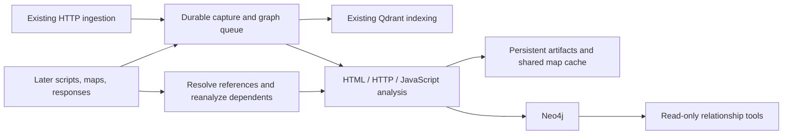
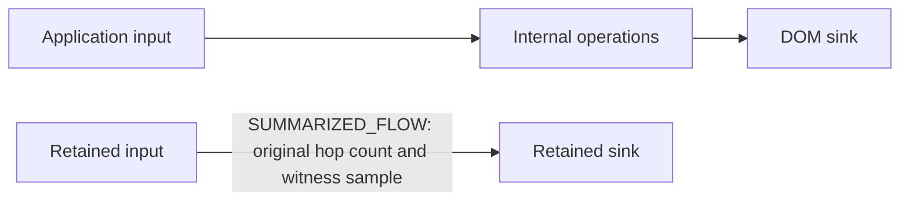
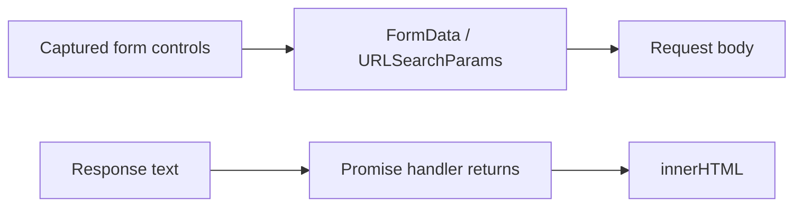

# Application relationship graph

[README](../README.md) · [Documentation index](README.md)

Neo4j stores an incremental graph of captured web application resources, forms, fields, scripts,
routes, and possible data flows. Graph processing uses the existing ingestion inputs. It does not
crawl links or fetch imports, API endpoints, manifests, or other discovered resources. JavaScript
scanning and graph analysis share source-map fetching and transformation caches: the existing
`.js.map` fetch remains permitted when `OPEN_WORLD=true`. With `OPEN_WORLD=false`, only supplied
maps are used. Inline maps and explicitly referenced maps already present in ingestion are supported.



Capture events are saved before vector-store normalization and deduplication. Repeated ingestion and
worker retries use deterministic identities. The graph retains response versions and evidence;
arrival order does not determine which version is latest. A dedicated worker activates each complete
capture atomically and reconciles references when their targets arrive later. Transient database failures
retain queued work; permanently failed analyses remain visible in monitoring.
Publication stages an immutable analysis generation using independent transactions of at most
500 records and approximately 4 MiB of serialized payload. Entities, evidence, relationships,
module/DOM links, and cleanup all use bounded transactions. A small final transaction activates the
complete generation; queries continue to see the previous successful analysis during reanalysis,
interruptions, and failures. Element IDs remain stable; evidence IDs identify immutable publication
evidence. Staged results are excluded from graph tools and statistics.
Progress logs identify committed batches, record counts, payload sizes, activation, and memory
budget failures. Transaction-memory errors subdivide the affected batch down to one record. If a
single record still cannot fit, the capture is recorded as a failed analysis and other work continues;
the prior complete graph remains available. Analyzer failures and timeouts remain analysis gaps.
Consuming-document context URL lists are stored on capture/publication metadata and resolved by graph queries,
avoiding repeated large properties on each JavaScript node and evidence record. Existing graph
records remain readable and adopt publication generations when reprocessed.
Committed staging batches can be replayed after a crash; acknowledgement loss after activation does
not republish the same generation. Superseded entities and relationships become eligible for bounded
cleanup after five minutes. A separate maintenance thread runs cleanup immediately after schema
readiness and every 60 seconds,
including when ingestion is idle. Health probes are read-only after schema initialization and never
run cleanup; publication completion does not run cleanup either. Maintenance cannot invalidate an
active graph. Published evidence and its context metadata are
retained, including evidence referenced by earlier saved result pages. Abandoned staging evidence
is reclaimed with its staged graph.

New reanalysis requests are coalesced by capture ID in a durable scheduler. Repeated requests
share one pending task; updates received during processing produce at most one follow-up task.
Different capture versions remain separate. Delivery tickets and persisted traversal budgets
preserve crash recovery and bound cycles to 32 captures per traversal. Existing queue entries
drain normally without compaction; only newly scheduled reanalysis uses coalescing. The dashboard
continues to show one count of queued and processing graph work. Graph producers do not reclaim
live tasks; the single graph worker performs recovery on startup. Scheduler state is added
automatically to the existing artifact SQLite database; no backfill rerun is required.

## Graph tools

All graph tools are read-only, work in low-power mode, and never make target requests.
Discovery and traversal tools require an explicit scope; evidence retrieval requires only an evidence ID.
Scope accepts a hostname, `host:port`, or HTTP(S) URL prefix. Hostname scopes include
subdomains on hostname boundaries; URL scopes restrict scheme, host, and path prefix.

| Tool | Purpose |
|------|---------|
| `find_application_endpoints` | Discover URL/method inventories quickly; request focused summaries for inputs, scripts, and flow candidates |
| `find_application_elements` | Discover resources, elements, fields, source reads, and sink operations; filter by `kinds`, `role`, or exact `url` |
| `find_application_relationships` | Inspect incoming or outgoing relationships around a returned element ID |
| `trace_application_data_flow` | Follow possible data flow forward to sinks or backward to sources |
| `find_user_journey_paths` | Find possible navigation, form-submission, and redirect paths between exact URLs or resource IDs |
| `fetch_application_graph_evidence` | Read the evidence, capture identity, source location, and inference rule behind a path step |

### Graph tool arguments

Types below are JSON types. Optional arguments accept their documented defaults; nullable filters
also accept `null`. IDs are opaque strings: copy them unchanged from the indicated response field.
All graph string arguments, including each `kinds` entry, ignore leading and trailing whitespace.
Case, internal whitespace, and URL escaping remain unchanged. Blank strings are not converted to `null`;
use `null` to omit a nullable filter.
Use the same application scope when passing element/resource IDs between discovery and traversal tools.
Evidence retrieval accepts only `evidence_id` and reads published evidence without waiting for indexing.
Possession of an evidence ID permits retrieval regardless of its URL or consuming-document context.
It returns the evidence object or `null` for missing or unpublished evidence, without an `indexing` field.
Begin domain/host discovery with `find_application_endpoints(detail="inventory")` (the default).
Each record includes a resource ID, URL, method, `capture_status`, and focused `follow_up` calls.
Inventory includes resources whose own URL matches scope, including assets; external dependencies
remain discoverable through focused relationship tools. Uncomputed inputs, scripts, sources, and
sinks are omitted, not reported as zero. `capture_status` is `captured` when a visible observed
`HOSTED_AT` relationship exists, `referenced` when that check completes without one, and `unknown`
when classification cannot finish. Referenced does not mean the resource has never been captured.

For inputs/forms, scripts, sources, and sinks, request `detail="summary"` with an exact `url` and
HTTP `method` when known. If the endpoint is already known and needs rich details, request its
summary directly. Avoid domain-wide summaries during reconnaissance. Summary sections each have
`count`, at most three `examples`, `examples_limited`, and concrete `follow_up` tool calls.
Counts describe graph elements in a bounded snapshot, not unique business inputs or a complete
application inventory. `association` distinguishes directly related nodes from script-context
candidates; a related script does not prove that an endpoint input reaches its sinks.

Inventory uses resource indexes and validates candidates in batches without loading summaries.
Graph execution has a 30-second budget with five-second read deadlines, separate from the
configurable indexing wait (default 60 seconds). Database termination and response delivery may add
small overhead. It scans at most 5,000 storage candidates and saves at most 1,000 unique resources;
`limit` controls saved-page size only. Completed records survive budget exhaustion. Inspect
`retrieval_truncated`, `truncation_reasons`, `analysis_gaps`, and indexing status. `scan_limit`,
`result_limit`, `time_limit`, and `memory_limit` explain incomplete selection. `classification_limit`
means capture-status checks stopped while resource selection continued. `lookup_unavailable`
means lookup migration or the resource index is not ready. Startup creates resource indexes for
existing data without reingestion; queries wait for online indexes rather than doing a broad scan.
Summaries retain the existing 120-second graph budget and captured/referenced classification.

Element discovery applies `context_url` and `role` filters in Neo4j before selecting and hydrating
its bounded snapshot. Context matching includes direct URL matches and consuming-document contexts
for external scripts. Unexpected graph query failures log the original exception and traceback;
clients receive the existing generic error. Startup automatically adds an index on publication
capture IDs for legacy context lookups.

Element discovery prioritizes resources, then fields/HTML elements, then code artifacts when
`kinds` is omitted. All four existing graph list tools now default to `detail="compact"`: nodes
retain IDs, kinds, names, roles, URLs, methods, and source locations; steps retain IDs, kinds,
source/target IDs, classifications, and evidence IDs. Use `detail="full"` for the previous public
properties, including context lists and module details. Filtering and path membership are identical.
IDs on saved pages have the same meaning as IDs on the first page (`get_result_page` wraps the producing response in `result`).

| Argument | Tools | Type / default | Purpose and values |
|----------|-------|----------------|--------------------|
| `detail` | `find_application_endpoints` | string; default `inventory` | `inventory` returns fast own-URL records; `summary` enriches selected endpoints, preferably with exact `url` and `method` |
| `method` | `find_application_endpoints` | string or null; default null | Exact HTTP method filter, ignoring case; e.g. `GET` or `POST` |
| `detail` | Elements, relationships, data flow, journeys | string; default `compact` | `compact` keeps essential identity and evidence fields; `full` returns all public properties |
| `context_url` | `find_application_elements` | string or null; default null | Exact page URL matched against an element’s own URL or its consuming-document contexts, including external scripts |
| `scope` | All except evidence retrieval | string, required | Hostname, `host:port`, or HTTP(S) URL prefix; restricts the application evidence queried |
| `kinds` | `find_application_elements` | array of strings or null; default null | Match any case-sensitive element kind, e.g. `resource`, `element`, `field`, `cookie`, `origin`; discover other values in `results[].kind`. Omitted, null, or `[]` applies no kind filter |
| `kinds` | `find_application_relationships` | array of strings or null; default null | Match any case-sensitive relationship kind, e.g. `CONTAINS`, `LOADS`, `NAVIGATES_TO`, `SUBMITS_TO`, `FLOWS_TO`; discover values in `results[].steps[].kind`. Omitted, null, or `[]` applies no kind filter |
| `role` | `find_application_elements` | string or null; default null | `source` reads input; `sink` consumes data. Null includes all roles. These static classifications are investigation candidates |
| `url` | `find_application_elements`, `find_application_endpoints` | string or null; default null | Exact element resource URL filter, rather than a prefix or text search; null applies no URL filter |
| `element_id` | `find_application_relationships` | string, required | Element ID from `find_application_elements.results[].id`, resource ID from `find_application_endpoints.results[].id`, or exact resource URL |
| `start` | `trace_application_data_flow` | string, required | Element ID from `find_application_elements.results[].id`, resource ID from `find_application_endpoints.results[].id`, or exact resource URL; resource starts select associated sources forward or sinks backward |
| `end` | `trace_application_data_flow` | string or null; default null | Element ID, resource ID, or exact resource URL; resource destinations select sinks forward or sources backward. Null seeks sinks forward or sources backward |
| `start`, `end` | `find_user_journey_paths` | strings, both required | Starting and destination exact captured resource URLs, or resource IDs from `find_application_endpoints.results[].id` or `find_application_elements.results[].id` queried with `kinds=["resource"]` |
| `direction` | Relationships and data flow | string; default `forward` | `forward` follows outgoing relationships; `backward` follows incoming relationships |
| `max_depth` | `find_application_relationships` | integer; default 1 | Maximum relationship steps, 1–3 |
| `max_depth` | Data flow and journeys | integer; default 8 | Maximum relationship steps, 1–32 |
| `historical` | All except evidence retrieval | boolean; default false | Include all retained capture versions when true; false selects latest versions |
| `as_of` | All except evidence retrieval | number or null; default null | Capture-time cutoff in Unix seconds, not milliseconds. With `historical=false`, selects latest captures at or before the cutoff; null applies no cutoff |
| `limit` | All except evidence retrieval | integer; default 5 for endpoints, 20 otherwise | Results per saved page, 1–1,000; follow `pagination.next_page_token` with `get_result_page` |
| `evidence_id` | `fetch_application_graph_evidence` | string, required | Copy `results[].steps[].evidence_id` from `find_application_relationships`, `trace_application_data_flow`, or `find_user_journey_paths` |

For domain discovery, call `find_application_endpoints`:

```json
{"scope":"example.com","detail":"inventory"}
```

For a known endpoint needing rich details, call it directly with `detail="summary"`:

```json
{"scope":"example.com","url":"https://app.example.com/api/v1/time","method":"GET","detail":"summary"}
```

For another page-associated summary:

```json
{"scope":"example.com","url":"https://example.com/blog","method":"GET","detail":"summary"}
```

Follow its suggested calls, or discover page-associated sources with `find_application_elements`:

```json
{"scope":"example.com","context_url":"https://example.com/blog","role":"source"}
```

Pass a returned source ID to `trace_application_data_flow`, or start from the exact resource URL:

```json
{"scope":"example.com","start":"https://example.com/blog","direction":"forward","max_depth":8}
```

Resource URLs select all matching methods; use a resource ID to select one method. Flow responses
include `resolved_start_count`, `resolved_end_count`, and up to 20 IDs per side in
`resolved_start_ids` / `resolved_end_ids`; `seed_ids_limited` reports omitted ID examples.
Seed selection uses direct associations and exact script contexts, not a flow edge. The tool then
traverses only existing flow relationships; it does not add containment or script-loading edges.
Missing seeds and selected seeds with no discovered path are reported separately in `analysis_gaps`.

Pass a returned `results[].steps[].evidence_id` to `fetch_application_graph_evidence`:

```json
{"evidence_id":"<evidence ID from a trace step>"}
```

Source/sink labels describe static operations, including ordinary input handling and network
boundaries. They do not establish attacker control. Framework symbols and generic property reads
do not establish prototype pollution or template injection. Captured HTTP traffic cannot establish
backend database queries or filesystem execution. Investigate actual paths and supporting evidence.

Find possible journeys with `find_user_journey_paths`:

```json
{"scope":"example.com","start":"https://example.com/signup","end":"https://example.com/account"}
```

Queries select the latest observations by capture time. Set `historical=true` to include retained
versions, or `as_of` to a Unix capture timestamp to query a historical cutoff. Missing capture times
use ingestion time and are flagged. Results contain observed, declared, or statically inferred
relationships with evidence IDs. List tools use saved-result pagination, defaulting to five endpoint
summaries or 20 other items per page. Follow `pagination.next_page_token` using `get_result_page`.

Traversal defaults to eight steps, with a maximum of 32; relationship inspection allows up to three.
Queries cap exploration at 10,000 entities, 20,000 relationships, 1,000 results, and ten seconds of
traversal CPU time. Database reads default to 30 seconds per transaction. `retrieval_truncated` and `truncation_reasons` report reached limits; `analysis_gaps` reports missing
artifacts or incomplete analysis. Cross-origin request/navigation destinations are boundaries;
supplied scripts used by scoped documents remain available for dependency and flow analysis.
Endpoint and element discovery select indexed resource/entity candidates before hydration. Exact URL,
method, kind, role, and context filters apply during selection. Endpoint summaries load only the
selected resources' associations. Context lookup uses indexed URL records instead of scanning entity
or publication context lists; normalized reversed hostnames preserve subdomain label boundaries.
A checkpointed maintenance backfill adds these access paths to existing data in bounded transactions.
New publications stage lookup records before activation. Until the backfill completes, discovery
uses the compatibility query within the same request budget; a timeout is reported as truncation.

All graph queries share a 120-second query budget after the separate indexing wait, within the
five-minute generation cleanup grace period. Reads use the configured transaction timeout (default
30 seconds) or the remaining budget, whichever is shorter, without automatic transaction retries.
Hydration loads immutable relationships, entities, metadata, and shared contexts in windows of at
most 500 input records. Shared dependencies and adjacency are cached per request. Resource-limit
failures subdivide batches; completed records remain available and results report time, memory,
and missing-generation limits. Repeat the query when a generation is unavailable.
Cancellation stops new batches and attempts to terminate only database reads tagged for that request;
external Neo4j users need permission to inspect and terminate their own transactions. If termination
is unavailable, the transaction timeout remains the bound for an already running read.
DEBUG logs report stage, batch size, returned records, elapsed time, and remaining budget. A completion
summary reports selected/completed relationships, memory subdivisions, and incompleteness reasons;
incomplete hydration is logged at WARNING. See [hydration measurements](graph_hydration.md).

Relationship, flow, and journey tools resolve indexed seeds and load bounded frontiers rather than
hydrating the entire application scope. Flow seed association includes direct inputs and contextual
scripts; association edges do not become flow evidence, and unlabelled intermediates remain traversable.
External destinations can be returned as boundary nodes but are not expanded beyond scope.
The 20,000-membership budget counts distinct relationships loaded for seed associations and traversal;
unrelated graph regions no longer displace focused paths. Shared dependencies and adjacency are cached
per request, with a shared 120-second database-work deadline, configurable read caps, and a separate
ten-second traversal CPU budget. No-path diagnostics describe the explored graph rather than claiming
application-wide absence of sources or sinks.

Each traversal reads a publication revision once. Activation atomically stamps publication and
retirement revisions, so reanalysis between frontier reads cannot mix generations. Existing active
publications are revision zero; older retired publications remain excluded, and legacy archives remain
readable. Startup initializes the revision counter and indexes; lookup backfill runs separately in maintenance.
**Upgrade with all older server processes stopped:** mixed-version writers do not maintain the revision
protocol. Keep the existing single-server deployment model. MCP arguments and saved-page schemas are
unchanged. DEBUG logs report frontier depth, batch/read counts, and cache sizes; completion logs report
path count, loaded memberships, elapsed time, and limiting reasons.

## Inference coverage and limits

HTML analysis extracts links, forms, submission overrides, fields, base URLs, frames, inline scripts,
event handlers, import maps, resource dependencies, and refresh navigation. HTTP analysis uses
redirects, Referer, Origin, Fetch Metadata, request parameter names, and typed Link headers.
Origin-only Referer values and subresource requests do not establish a navigation step. Supplied CSS,
web manifests, OpenAPI documents, and Vite build manifests contribute explicit relationships.

The JavaScript analyzer parses delivered or source-map-recovered JavaScript, JSX, TypeScript, and
TSX without evaluating the application. It follows lexical bindings, assignments, expressions,
parameters, returns, calls, callbacks, and imports/exports. It recognizes common browser sources and
sinks, fetch/XHR, Axios/Angular HTTP calls, storage access, navigation, workers, and messaging.
Explicit imported function argument/return interfaces link across ingested modules. Processing is
bounded to 40 MiB per source artifact, 10,000 semantic nodes and 20,000 edges per script, and 240
seconds per analyzer container, with a 3 GiB container memory limit.

Framework models cover React/Next.js links, forms, state and HTML sinks; Vue/Nuxt bindings, navigation
and HTTP helpers; Angular delivered templates, forms, routing and HttpClient; and Svelte/SvelteKit
bindings, links, forms and navigation. Vite support includes native modules, generated lazy/glob
imports, and supplied build-manifest chunk/CSS/asset dependencies. An unexpanded glob cannot reveal
files that were not supplied. Recovered source-map paths are virtual identifiers, not fetchable URLs
or filesystem destinations.

This is bounded, conservative static analysis. Dynamic dispatch, runtime-generated URLs, aliases
without explicit mappings, framework transformations, missing modules, and backend implementation
can leave gaps. Source/sink classifications and paths are candidates for investigation, not confirmed
vulnerabilities. Recognized transformations do not prove sanitization. Captures do not identify browser
sessions, so journey paths are possibilities rather than recorded user sessions. Session storage is
not joined across unrelated captures. Historical paths can span observations at different times.

## Large-script summaries and graph size estimates

By default, scripts exceeding 2,000 generated nodes or 4,000 edges are compressed, regardless of
library name, version, filename, or formatting. This includes application scripts and mixed bundles.
Smaller scripts retain detailed graphs. Source-map recovery remains enabled, and embedded sources
are analyzed individually. Set `GRAPH_LIBRARY_ANALYSIS=full` to bypass compression within the normal
detailed-analysis limits; the variable keeps its existing name for compatibility.

Summaries prioritize security sources/sinks, import/export and resolved callback boundaries, DOM
bindings, then reference origins. They retain at most 500 endpoints, 500 flow relationships, and 50
resource references per script. Direct endpoint edges retain their original evidence. Internal directed
flow paths become `SUMMARIZED_FLOW` edges with original hop counts, endpoint locations, and samples
of the first four and last four edges. Paths have no fixed depth cutoff; traversal stops at the next
retained endpoint and is bounded to 100,000 edge visits per script. Summary edges participate in flow
traces, not user journeys. They indicate static reachability with intermediate operations omitted;
they do not prove runtime execution, sanitization, or exploitation.



Summary-mode initial analysis permits 50,000 nodes and 100,000 edges; full mode retains its existing
10,000-node and 20,000-edge limits. Parsing, subprocess, and capture limits still apply. Compression
reduces stored graph size and downstream query work, but does not avoid initial parsing and analysis.
Publication allows up to 1,000 nodes and 2,000 relationships per summarized script, including auxiliary
reference/context facts, within capture-wide limits. Endpoint nodes and their flows precede references.
`analysis_summaries` reports input/output counts, omitted endpoint categories and references, and
separate analysis, traversal, selection, and publication limit flags. Limits can omit security endpoints
or connections; a missing path does not establish safety. Original captures remain available.

Existing stored graphs change only when rebuilt. The updated analyzer policy invalidates cached
analysis and makes captures eligible for the normal rebuild workflow; it does not rebuild automatically.
Use the rebuild command with `--mode full` to request detailed analysis.

The `/status` graph counts are publication estimates, not unique graph record counts. **Current graph**
sums the latest completed captures per resource; **retained history** sums all completed captures.
Shared resources and other logical entities can be counted once per capture. Relationships whose
external endpoints were subsequently replaced may be overcounted. Network documents are a separate
vector-store representation and need not match the number of graph captures.

Counts are computed during publication and read from capture metadata, without entity/relationship
scans. The shared status service caches estimates for five minutes and refreshes in the background.
It shows unavailable or stale values if needed, and reports partial coverage for older captures
without count summaries. Existing API fields `entities` and `relationships` alias the approximate
retained-history counts; `current` and `retained_history` expose `entity_estimate`,
`relationship_estimate`, capture/resource counts, and coverage. Status also includes refresh time
and age. Empty graphs report zero; wholly uncovered graphs report unavailable estimates.
Neo4j connection health and its address are reported independently of statistics refreshes.
If a refresh fails, status includes the error type or Neo4j error code, and the diagnostic log
contains the full exception. A green Neo4j indicator confirms connectivity, not successful statistics.
Neo4j statistics use one five-second transaction without automatic retries and return gap flags
rather than full gap descriptions. Unresolved-reference counts also refresh in the background at
most once every five minutes, checking each distinct referenced URL once. Their independent
`reference_statistics_refreshed_at`, `reference_statistics_age_seconds`,
`reference_statistics_stale`, and `reference_statistics_error` fields describe freshness and failures;
failed refreshes retain the last successful count. Queue and analysis counts still refresh with the
monitor's 30-second cycle. Qdrant domain/host statistics use exact indexed facet counts
and refresh at most once every five minutes, independently of graph activity.

The terminal monitor uses **Application graph activity** instead of graph-size estimates. It reads
Neo4j's indexed `publication_revision` state record in a single two-second read transaction, at
most once every 30 seconds, without scanning captures, entities, relationships, or references.
Each successful publication activation increments this counter atomically; reanalysis publications
also increment it, so it is not a unique-capture count. The monitor's second row contains database
statistics on the left,
graph activity in the middle, and domain/host statistics on the right. The graph panel shows
separate lines for each activity and continuation metric; graph queue counts are omitted from the
queue panel to avoid duplication. The graph panel scrolls when its metrics exceed the available height:

```text
Publication revision: 19371
Change since sample: +3
Last observed advance: 0s ago
Completed analyses: 18448
Processing: 1
Queue depth: 18680
Failed: 0
```

The first successful sample establishes a baseline. An unchanged revision means no publication
completed between samples; analysis or staging may still be working. The elapsed time starts when
this server observes an increase, not at the actual commit time. A decreasing or missing counter
clears the baseline. Failed refreshes keep the previous values and mark them stale; the monitor
shows the error type or Neo4j code. Queue depth includes pending and claimed items. Activity fields
in `/status` are `publication_revision`, `publication_revision_delta`,
`seconds_since_observed_progress`, and `activity_refreshed_at`, `activity_age_seconds`,
`activity_stale`, plus `activity_error`/`activity_error_code` on failures. Observation history resets
when the server restarts. The monitor does not schedule the expensive estimate or reference-count
refreshes; explicit `/status` requests retain those existing fields and caches.


## Resumable shared-script linking

External JavaScript and source-map captures with response bodies use durable continuation jobs.
Dependency discovery reads referenced captures in deterministic pages, retaining all consuming page
contexts rather than imposing a document-coverage cap. Cycles are deduplicated. The extracted
projection is saved once; repeated context URL arrays are shared in checkpoints and publication
digests to avoid serializing the same thousands of URLs for every evidence record.

The worker alternates one normal queue item with one ready continuation slice. Discovery,
planning, and reconciliation yield between bounded batches. Planning slices consider at most 100
contexts or 200 database reads and check a 30-second budget between operations. Each planning
read uses a five-second transaction without driver-managed retries. Extraction and final
publication keep their existing operation bounds; the slice budget does not interrupt an AST
analyzer or an in-flight operation. Identical selectors share context queries, matching elements
are filtered before evidence hydration, and completed contexts are not reread after recovery.

Only a finished plan proceeds to staged publication and atomic activation. The previous generation
remains visible meanwhile. Existing node, edge, and inferred-link limits still produce explicit
analysis gaps; continuations do not add a context-coverage cap. Late dependencies use the existing
reanalysis scheduler and receive a fresh discovery pass.

Timeouts and memory failures split candidate/hydration batches. Transient Neo4j connection,
transaction-timeout, read-only, and retryable server errors remain pending for automatic retry.
Continuation retries back off for 5, 30, then 120 seconds, capped at 120 seconds until recovery;
their queue receipts remain processing without a success or failed acknowledgement.
Terminal storage failures mark the continuation and its original queue items failed and require explicit retry.
Generation conflicts restart planning from the saved extracted projection. Failed checkpoints and
errors remain available for investigation. Successful jobs retain a small completion record and
remove their saved projection. New work for the same capture runs in order; a successful replacement
supersedes older failed continuations for that capture.

Graph status adds `continuations`: pending/running/failed counts, the most recent stage,
`contexts_completed`, `contexts_discovered`, and `checkpoint_age_seconds`. The monitor shows
these values on separate lines in its graph panel. Checkpoints do not increment the publication revision.
The original graph queue items remain processing through continuation publication and reconciliation.
Durable queue receipts preserve their row IDs across restarts, including duplicate deliveries.
Only completed publication and reconciliation acknowledge success; terminal failures mark those rows failed.
Retrieval indexing waits include both queue and continuation work, so a handoff cannot look complete.

Continuation tables and indexes are added when the graph worker starts. Restarting reclaims running
jobs and resumes their saved cursors. Existing queue payloads and published graphs remain compatible;
failed queue items are not automatically retried or rebuilt. Explicit graph rebuild scheduling can
create new work for failed continuations; the failed-queue retry action resumes their checkpoints.
Existing continuations handed off by older versions lack queue receipts: their failures remain in
graph continuation/work status, but previously acknowledged queue rows cannot be reconstructed.
No data-directory migration is needed.

## JavaScript data-flow coverage

The analyzer separates call arguments from return values and models Promise fulfillment and rejection
independently. Supported patterns include expression-bodied arrows, lexical callback aliases, nested
`then` chains, `catch`, `finally`, `Promise.resolve`/`reject`, and `async`/`await`. Constant returns stop
incoming value propagation. Conditional tests do not create implicit data-flow edges.

Fetch response readers and properties on recognized XMLHttpRequest instances are external sources.
Request bodies remain separate from response values: a captured request never proves server reflection.
For example, the form-submission pattern has two independent paths:



Literal form selectors bind `FormData(form)`, regular submit-handler `this`, and
`event.currentTarget` to controls in the captured consuming document. Named `FormData.get`/`getAll`
reads select the requested field. Disabled, unnamed, unchecked, and non-data controls are excluded.
Form action and method can resolve a fetch destination when both trace to the same captured form.
Use literal ID selectors or `form[name="..."]` for form ownership; computed selectors remain unresolved.

Module argument/return interfaces support named/default imports, namespace member calls, lexical
aliases, and explicit named re-exports. Re-export chains are bounded to 32 links and retain supporting
evidence and capture-version constraints. Shared globals, computed dispatch, missing modules, and
unknown calls remain conservative summaries or explicit analysis gaps. General heap analysis,
call-site sensitivity, implicit control flows, and backend execution are not modeled.

An empty trace distinguishes missing seeds, missing source/sink operations, disconnected edges,
requested scope boundaries, and reached traversal limits through `analysis_gaps` and truncation
metadata. No result establishes safety. Broaden scope only when authorized, and inspect step evidence.
The analyzer policy version is now 3; existing captures require an explicit rebuild to gain these links.

Rebuild retained captures explicitly after updating the analyzer image and restarting the service:

```shell
uv run python -m shyhurricane.graph.rebuild \
  --data-dir assessment --target example.com --dry-run
uv run python -m shyhurricane.graph.rebuild \
  --data-dir assessment --target example.com --mode summary
```

Omit `--target` to rebuild all retained captures, or use `--mode full` for detailed library analysis.
Rebuilds use retained artifacts without fetching source maps, durably record the requested per-capture
policy, and require the graph worker to be running to consume queued work. That policy also applies
when those captures are reconciled later. Repeating a command skips pending or successfully completed
work for the current analyzer version and policy; failed work can be queued again. The old publication
remains queryable until replacement succeeds, and existing bounded cleanup reclaims retired records.
Rebuilding also populates missing count summaries. Startup never rebuilds or counts graph records.

## Neo4j operation and storage

Neo4j is required. Source runs create, start, or reuse a managed container, binding Bolt to an
available loopback port and mounting the configured host directory at `/data`, with persistent logs.
The default directory is `<data-dir>/graph`. Shutdown retains the container and data.
Both Compose configurations supply a private `graph` service with `neo4j-data` and `neo4j-logs`
volumes. No graph ports are published by Compose. Managed private deployments use the same
unauthenticated connection model as Qdrant; external servers can use credentials.

| Environment variable | Default | Description |
|----------------------|---------|-------------|
| `GRAPH_LIBRARY_ANALYSIS` | `summary` | `summary` compresses scripts exceeding 2,000 generated nodes or 4,000 edges while retaining bounded security endpoints and flow summaries; `full` bypasses compression within ordinary analysis limits |
| `NEO4J` | Unset; `bolt://graph:7687` in Compose | External Bolt/Neo4j server URI; managed local storage uses `<data-dir>/graph` |
| `NEO4J_USERNAME` | `neo4j` | Username when `NEO4J_PASSWORD` is supplied |
| `NEO4J_PASSWORD` | Unset | Password for authenticated connections; also initializes authentication on a newly created managed container |
| `NEO4J_HEAP_SIZE` | `1g` | Initial and maximum JVM heap for newly created managed containers and the Compose graph service |
| `NEO4J_PAGECACHE_SIZE` | `1g` | Neo4j page-cache allocation for managed containers and the Compose graph service |
| `NEO4J_TRANSACTION_MEMORY_LIMIT` | Unset; Neo4j defaults to 70% of maximum heap | Optional combined transaction-memory budget for managed containers and the Compose graph service; must not exceed heap size |
| `NEO4J_READ_TIMEOUT_SECONDS` | `30` | Ordinary graph reads, including evidence, traversal, hydration, and dependency queries |
| `NEO4J_CONTROL_TIMEOUT_SECONDS` | `30` | Publication begin, activation, and abandonment transactions |
| `NEO4J_WRITE_TIMEOUT_SECONDS` | `180` | Publication payload batch transactions |
| `NEO4J_HEALTH_TIMEOUT_SECONDS` | `15` | Read-only application health probes after schema initialization |
| `NEO4J_SCHEMA_TIMEOUT_SECONDS` | `120` | Schema transactions and waiting for indexes to become available |

Timeout overrides accept finite positive seconds and apply to managed and external servers through
client transaction settings. Invalid values fail before graph services start. Explicit shorter caller
budgets take precedence. Activity/statistics probes keep their shorter budgets; link-planning reads
are capped by the remaining planning slice. Traversal/hydration retain a 120-second total database
budget and the five-minute generation-retention grace period. Indexing waits remain separately configured.
Transaction timeouts are not strict wall-clock limits on commits, retries, or filesystem operations.

Cleanup eligibility uses a `GraphCleanupPending` label indexed by retirement time and publication ID.
Publication retirement and abandonment apply the label directly; successful cleanup removes it while
retaining published evidence. Background maintenance does not scan older publications to add the label.
Cleanup runs before lookup migration, with separate cooperative 30-second budgets and independent retry
schedules. Slow or failed lookup migration cannot consume cleanup's budget or put cleanup into backoff;
cleanup failures likewise do not prevent lookup migration. Each operation normally runs 60 seconds after
completion. Failures do not affect readiness and independently back off for 60, 120, 240, 480, then
at most 900 seconds; success resets only that operation's retry schedule.
Lookup migration scans at most 1,000 batches per attempt within its time budget, initially 500 records
per batch. It halves its next batch after a transaction timeout, transaction-memory failure, or a
successful attempt taking more than 15 seconds, down to one record. The learned size lasts for the
server process; restarting starts at 500 again while resuming the durable cursor. Failed transactions
never advance that cursor.
Cleanup selects at most five candidates and deletes at most ten batches of 500 records. Shutdown
is checked between transactions and operations; slow commits can exceed cooperative budgets.
Logs report lookup progress, selected/completed publications, deleted records, elapsed time,
failed operation, and next-attempt delay.

Memory overrides accept positive integer sizes with `k`, `m`, or `g` suffixes, ignoring case.
They do not configure externally supplied Neo4j servers. A transaction-memory-limit error can occur
while Docker reports low overall memory use because Neo4j enforces its own transaction budget.
Heap and page cache also require headroom for native JVM memory and other services.

Set the memory variables in `.env` for Compose and recreate only the graph service:

```shell
docker compose up -d --force-recreate graph
```

Existing managed containers are reused without changing their memory settings. Startup warns when
their settings differ. To apply overrides, stop ShyHurricane, identify its exact managed container
name in the warning, then remove that container without removing its bind-mounted data directory:

```shell
docker stop <managed-container-name>
docker rm <managed-container-name>
NEO4J_HEAP_SIZE=1g uv run python mcp_service.py
```

The next startup recreates the container using the existing data and log mounts. No graph backfill
is required. Do not remove the graph directory or Compose volumes when applying memory settings.
After upgrading, already queued captures retry through bounded publication; captures explicitly
failed for an exhausted single-record budget require resubmission or a new reanalysis request.

Ingest, type-specific indexing, and graph workers pause while Neo4j is unhealthy, alongside existing
dependency checks. `/index` continues accepting durable queued work. Workers resume automatically.
The terminal dashboard and `/status` expose graph health, counts, queued work, failed analyses, and
unresolved references. Graph-statistics failures do not prevent other status reporting.

Original captures, transformation caches, reference indexes, and graph queues persist in the existing
per-database state directory (`/data/queues` in Compose). Graph artifacts and evidence have no automatic
expiration. Saved tool-result pages retain their existing expiration policy.

## Backfill existing indexed content

Run the server normally, then queue an offline backfill:

```shell
uv run python -m shyhurricane.graph.backfill --data-dir assessment
```

Use the same Qdrant database and persistent state location as the server. Backfill reads existing
content, network, and forms collections without target requests, including without map fetching.
It checkpoints submitted items and resumes on the next invocation. Existing normalized documents
cannot reconstruct missing request bodies, original markup, or discarded observations; resulting
evidence explicitly reports that limitation.
