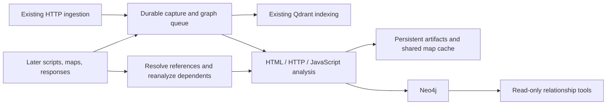
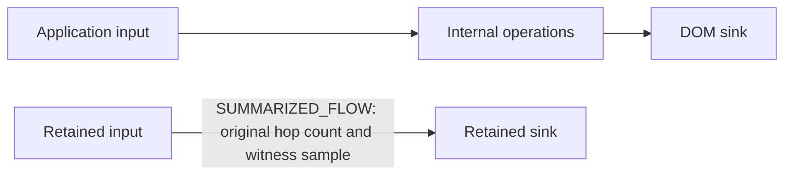
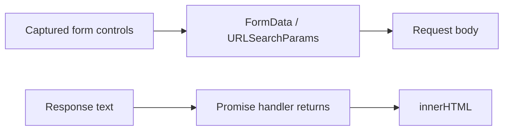

# Application relationship graph

[README](../README.md) · [Documentation index](README.md)

Neo4j stores an incremental graph of captured web application resources, forms, fields, scripts,
routes, and possible data flows. Graph processing uses the existing ingestion inputs. It does not
crawl links or fetch imports, API endpoints, manifests, or other discovered resources. JavaScript
scanning and graph analysis share source-map fetching and transformation caches: the existing
`.js.map` fetch remains permitted when `OPEN_WORLD=true`. With `OPEN_WORLD=false`, only supplied
maps are used. Inline maps and explicitly referenced maps already present in ingestion are supported.



Capture events are saved before vector-store normalization and deduplication. Repeated ingestion and
worker retries use deterministic identities. The graph retains response versions and evidence;
arrival order does not determine which version is latest. A dedicated worker activates each complete
capture atomically and reconciles references when their targets arrive later. Transient database failures
retain queued work; permanently failed analyses remain visible in monitoring.
Publication stages an immutable analysis generation using independent transactions of at most
500 records and approximately 4 MiB of serialized payload. Entities, evidence, relationships,
module/DOM links, and cleanup all use bounded transactions. A small final transaction activates the
complete generation; queries continue to see the previous successful analysis during reanalysis,
interruptions, and failures. Element IDs remain stable; evidence IDs identify immutable publication
evidence. Staged results are excluded from graph tools and statistics.
Progress logs identify committed batches, record counts, payload sizes, activation, and memory
budget failures. Transaction-memory errors subdivide the affected batch down to one record. If a
single record still cannot fit, the capture is recorded as a failed analysis and other work continues;
the prior complete graph remains available. Analyzer failures and timeouts remain analysis gaps.
Consuming-document URLs and capture memberships are stored as indexed context rows, keeping activation
payloads independent of context fanout and avoiding repeated lists on JavaScript nodes and evidence. Existing graph
records remain readable and adopt publication generations when reprocessed.
Committed staging batches can be replayed after a crash; acknowledgement loss after activation does
not republish the same generation. Superseded entities and relationships become eligible for bounded
cleanup after five minutes. A separate maintenance thread runs cleanup immediately after schema
readiness and every 60 seconds,
including when ingestion is idle. Health probes are read-only after schema initialization and never
run cleanup; publication completion does not run cleanup either. Maintenance cannot invalidate an
active graph. Published evidence and its context metadata are
retained, including evidence referenced by earlier saved result pages. Abandoned staging evidence
is reclaimed with its staged graph.

Graph production uses durable, finite analysis epochs. An epoch freezes retained captures and
analysis policies through revision-filtered SQLite views; arrivals during processing wait for the next
epoch. Source maps fetched in open-world mode are pinned and reused throughout that epoch. Reference discovery finishes before structural publication. Consuming-document discovery
then follows references in bounded, cycle-safe pages. Browser-relative lazy dependencies are
resolved to a fixed point before final analysis, reusing discovery cursors and cached AST results.
Cached AST results are shared between
reference discovery and the final context analysis. Only actual load/import dependencies and their
consumers are affected; navigation links do not invalidate other captures. Completed job rows are
compacted before the next epoch. The catalog stores revision markers rather than full database copies. Planning checkpoints omit
HTTP bodies and reload the immutable capture only when extraction needs it.

Each capture has at most one structural activation and one inferred-link activation per epoch.
Structural work finishes for every capture before inferred-link planning starts. Inferred links
have their own publication pointer and never replace structural entity or evidence IDs. A sliced
planner therefore sees stable dependencies even when more captures arrive. Completion does not
schedule another reconciliation traversal. Duplicate input deliveries create no additional epoch.
Queue receipts remain processing until their epoch completes or fails, including across restarts.
The worker checks for new inputs before each epoch step and advances runnable work without an
input-queue timeout. When no work can run, it waits up to one second before checking again;
future retries and failed inputs awaiting explicit redelivery do not cause busy polling.

`/status` includes `graph.epoch` with the epoch ID, phase, affected/completed capture counts,
outstanding jobs, waiting inputs, unchanged-publication count, activation counts, conflicts, and
errors. The epoch phases are `references`, `contexts`, `structural`, `links`, `done`, and `failed`.
Transient database failures retain the current checkpoint with bounded retry backoff. Unexpected
publication conflicts and permanent capture failures quarantine that capture and block its consumers.
Independent captures continue. Retry failed inputs explicitly through the dashboard. A catalog-wide
failure stops the epoch visibly; newer inputs remain durable.

### Graph-state storage

`graph_state/artifacts.sqlite` holds captures, shared response/source text, complete IR, detail
shards, manifest facts, and restart checkpoints. Artifacts use compact JSON encoded as Zstandard
level 1 BLOBs, or raw bytes when compression would enlarge them. SHA-256 content addresses share
identical payloads and large text across captures and projections. Readers validate encoding version,
decoded size, and checksum. Opaque references identify immutable content, not file paths. Replacing a
checkpoint creates a new reference; parser workers receive the epoch snapshot reference explicitly.
Nested artifact dependencies resolve to existing immutable objects, forming an acyclic graph.

The manifest interns repeated identifiers and URLs as integer keys. Context documents are stored
once per distinct version, with separate compact membership tables. Indexed metadata selects bounded
candidates before payload decompression; public IDs, pagination order, snapshot watermarks, temporal
selection, and coverage semantics remain independent of storage keys.

Captured evidence, successful external source-map responses, complete analysis, and expansion shards
remain retained. External source-map evidence remains unverified; retaining it does not establish
that it matches delivered JavaScript. Recomputable extraction
caches use least-recently-used eviction, with a default 256 MiB compressed-content budget per
assessment. Shared text is counted once and evidence-owned content is excluded from the cache budget.
`0` disables new cache retention. Maintenance evicts in bounded batches, so an over-budget cache may
need multiple passes. Cache eviction never removes content referenced by retained evidence or active
checkpoints. Nested artifact references are tracked explicitly.

Completed jobs retain completion metadata rather than checkpoint artifacts. Successful epochs release
snapshots and pinned source-map records; unused content is reclaimed asynchronously. Newly staged
objects have a one-hour grace period before orphan reclamation. A cache hit renews this grace before
returning nested references, allowing the caller to save its next checkpoint safely. Eviction drops
the cache key while preserving this read/staging grace, so physical disk usage may remain above the
cache budget temporarily; `staged_bytes` reports this allocation. Complete reads use SQLite snapshots.
Parser output is temporary and is
removed after parsing; a worker restart removes abandoned parser output before starting new parsers.
There are at most 64 artifact lock files, independent of artifact count. A small
`cache-leases.sqlite` coordinates exact cache keys without holding bucket locks across nested parser
processes; expired leases or leases from exited processes can be reclaimed.

Ownership, cache roots, and dependency edges update reference counts transactionally. Blob usage
metadata is separate from compressed payloads, so accounting changes do not rewrite large bodies.
Unique logical/stored byte totals update at insertion and deletion; retained/cache classification
changes propagate through a durable work queue. Each edge records its applied contribution, making
retries and overlapping changes idempotent without a whole-catalog reachability scan.

Independent maintenance processes at most 500 items per pass in committed sub-batches of at most 64
items, cooperatively bounded by two seconds. Each item updates one dependency, cache key, or garbage
candidate using indexed lookups. A deadline yields normally and preserves earlier commits; pending
work is retried after one second, idle maintenance after 60 seconds. Deletions recheck physical reference counts transactionally and release
children incrementally. Newly unreferenced content becomes an indexed reclamation candidate.

SQLite `BUSY`/`LOCKED` contention during graph storage maintenance is a normal deferral.
Maintenance retains committed batches, rolls back the active batch, and retries after one second
without failure backoff. Deferrals are logged at INFO with the stage, SQLite code, and committed
item count. Other database failures retain warning logs and exponential retry backoff.

Incremental vacuum and passive WAL checkpointing get a separate short budget even when accounting
yields. Readers can delay physical reclamation. Normal operation never runs a full vacuum. Neo4j has
its own retired-generation cleanup and may reuse allocation rather than return it to the filesystem.

`graph.storage` in `/status` reads aggregate counters and allocation metadata. It reports
`logical_payload_bytes`, `stored_payload_bytes`, `retained_bytes`, `cache_bytes`, `staged_bytes`, cache
budget, database/WAL allocation, and reclaimable SQLite bytes. Classification totals can temporarily
lag while `accounting_pending` is true. `pending_work_count` counts queued classification jobs and
retiring nodes; `last_maintenance_progress_at` is the Unix timestamp of the last committed work.
Maintenance continues enforcing the cache budget as classification converges.

Refreshes run in the background; `storage_stale`, refresh time, and errors indicate when samples are
unavailable or old. Counters are consistent within a SQLite read transaction; measurements are not an
atomic snapshot across SQLite, filesystem allocation, and Neo4j.

For an isolated artifact-format comparison, install development dependencies and run:

```shell
UV_CACHE_DIR="$PWD/.uv-cache" uv run python .github/scripts/benchmark-graph-storage.py \
  --corpus /path/to/artifacts-or-index.jsonl --output /tmp/graph-storage-benchmark.json
```

The benchmark reads a bounded sample without changing the source, and compares JSON files, raw SQLite,
LZ4, Zstandard level 1, and the production deduplicating artifact store in temporary databases. It
reports allocation, file counts, write time, warm-cache read latency, and peak Python allocations;
native codec/SQLite allocations are excluded. This comparison does not measure catalog normalization.

## Graph tools

All graph tools are read-only, work in low-power mode, and never make target requests.
Discovery and traversal tools accept an explicit scope or infer it from a supplied HTTP(S) URL;
evidence retrieval requires only an evidence ID.
Scope accepts a hostname, `host:port`, or HTTP(S) URL prefix. Hostname scopes include
subdomains on hostname boundaries; URL scopes restrict scheme, host, and path prefix.

Explicit nonblank scope takes precedence. Omitted, null, or blank scope is inferred from `url`
for endpoints, `context_url` before `url` for elements, URL-valued `element_id` for relationships,
and URL-valued `start` for flow traces and journeys. Opaque IDs require explicit scope; `end`
never supplies scope. An invalid selected URL produces an error rather than falling back to
another argument. Inferred scope uses the hostname and explicit port, including IPv6 brackets;
paths, queries, and fragments stay in the original selector but are excluded from scope.
URLs must be absolute HTTP(S) URLs with valid hosts and ports and no credentials.
For example, `find_application_endpoints(url="https://app.example.com:8443/api/items?id=1")`
uses scope `app.example.com:8443`. Existing hostname scope semantics include subdomains.

| Tool | Purpose |
|------|---------|
| `find_application_endpoints` | Discover URL/method inventories quickly; request focused summaries for inputs, scripts, and flow candidates |
| `find_application_elements` | Discover resources, elements, fields, source reads, and sink operations; filter by `kinds`, `role`, or exact `url` |
| `find_application_relationships` | Inspect incoming or outgoing relationships around a returned element ID |
| `trace_application_data_flow` | Follow possible data flow forward to sinks or backward to sources |
| `find_user_journey_paths` | Find possible navigation, form-submission, and redirect paths between exact URLs or resource IDs |
| `fetch_application_graph_evidence` | Read the evidence, capture identity, source location, and inference rule behind a path step |

### Graph tool arguments

Types below are JSON types. Optional arguments accept their documented defaults; nullable filters
also accept `null`. IDs are opaque strings: copy them unchanged from the indicated response field.
All graph string arguments, including each `kinds` entry, ignore leading and trailing whitespace.
Case, internal whitespace, and URL escaping remain unchanged. Blank strings are not converted to `null`;
use `null` to omit a nullable filter.
Use the same application scope when passing element/resource IDs between discovery and traversal tools.
Evidence retrieval accepts only `evidence_id` and reads published evidence without waiting for indexing.
Possession of an evidence ID permits retrieval regardless of its URL or consuming-document context.
It returns the evidence object or `null` for missing or unpublished evidence, without an `indexing` field.
Begin domain/host discovery with `find_application_endpoints(detail="inventory")` (the default).
Each record includes a resource ID, URL, method, `capture_status`, and focused `follow_up` calls.
Inventory includes resources whose own URL matches scope, including assets; external dependencies
remain discoverable through focused relationship tools. Uncomputed inputs, scripts, sources, and
sinks are omitted, not reported as zero. Inventory `capture_status` is `captured` when a selected captured resource fact exists
for that URL and method, and `referenced` when the check completes without one. Referenced does not mean the resource has never been captured.

For inputs/forms, scripts, sources, and sinks, request `detail="summary"` with an exact `url` and
HTTP `method` when known. If the endpoint is already known and needs rich details, request its
summary directly. Avoid domain-wide summaries during reconnaissance. Summary sections each have
`count`, at most three `examples`, `examples_limited`, and concrete `follow_up` tool calls.
Counts describe graph elements in a bounded snapshot, not unique business inputs or a complete
application inventory. `association` distinguishes directly related nodes from script-context
candidates; a related script does not prove that an endpoint input reaches its sinks.

Inventory reads resource facts through URL and hostname indexes without loading summaries.
It processes at most five batches of 1,000 storage candidates and retains at most 1,000 unique
resources per query response; `limit` controls saved-page size only. Inventory and element
discovery have a 120-second request budget, including metadata, separate from the configurable
indexing wait (default 60 seconds). Response delivery may add small overhead. Completed records
survive budget exhaustion. Inspect `retrieval_truncated`, `truncation_reasons`, `analysis_gaps`,
and indexing status. `page_limit` means more candidates remain; `time_limit` means execution
reached its deadline. Follow the continuation token to resume without losing discovery records.
Existing discovery manifests need no index migration or reingestion for these query changes.
Summaries share the same 120-second graph budget and captured/referenced classification.

Element discovery applies `context_url` and `role` filters to the paged discovery manifest before
selecting records; deferred elements retain stable IDs for offline expansion. Context matching includes direct URL matches and consuming-document contexts
for external scripts. Unexpected graph query failures log the original exception and traceback;
clients receive the existing generic error. Startup automatically adds an index on publication
capture IDs for legacy context lookups.

Element discovery prioritizes resources, then fields/HTML elements, then code artifacts when
`kinds` is omitted. All four existing graph list tools now default to `detail="compact"`: nodes
retain IDs, kinds, names, roles, URLs, methods, and source locations; steps retain IDs, kinds,
source/target IDs, classifications, and evidence IDs. Use `detail="full"` for the previous public
properties, including context lists and module details. Filtering and path membership are identical.
Retained discovery applies the same detail choice on continuation. Compact records preserve manifest,
analysis-unit and capture IDs, coverage statuses, and follow-up calls needed for offline expansion.
IDs on saved pages have the same meaning as IDs on the first page (`get_result_page` wraps the producing response in `result`).

| Argument | Tools | Type / default | Purpose and values |
|----------|-------|----------------|--------------------|
| `detail` | `find_application_endpoints` | string; default `inventory` | `inventory` returns fast own-URL records; `summary` enriches selected endpoints, preferably with exact `url` and `method` |
| `method` | `find_application_endpoints` | string or null; default null | Exact HTTP method filter, ignoring case; e.g. `GET` or `POST` |
| `detail` | Elements, relationships, data flow, journeys | string; default `compact` | `compact` keeps essential identity and evidence fields; `full` returns all public properties |
| `context_url` | `find_application_elements` | string or null; default null | Exact page URL matched against an element’s own URL or its consuming-document contexts, including external scripts |
| `scope` | Discovery and traversal | string or null; default null | Hostname, `host:port`, or HTTP(S) URL prefix; inferred from the primary URL when missing; required for opaque-ID-only calls |
| `scope` | `expand_application_graph_analysis` | string, required | Explicit application scope for offline expansion |
| `kinds` | `find_application_elements` | array of strings or null; default null | Match any case-sensitive element kind, e.g. `resource`, `element`, `field`, `cookie`, `origin`; discover other values in `results[].kind`. Omitted, null, or `[]` applies no kind filter |
| `kinds` | `find_application_relationships` | array of strings or null; default null | Match any case-sensitive relationship kind, e.g. `CONTAINS`, `LOADS`, `NAVIGATES_TO`, `SUBMITS_TO`, `FLOWS_TO`; discover values in `results[].steps[].kind`. Omitted, null, or `[]` applies no kind filter |
| `role` | `find_application_elements` | string or null; default null | `source` reads input; `sink` consumes data. Null includes all roles. These static classifications are investigation candidates |
| `url` | `find_application_elements`, `find_application_endpoints` | string or null; default null | Exact element resource URL filter, rather than a prefix or text search; null applies no URL filter |
| `element_id` | `find_application_relationships` | string, required | Element ID from `find_application_elements.results[].id`, resource ID from `find_application_endpoints.results[].id`, or exact resource URL |
| `start` | `trace_application_data_flow` | string, required | Element ID from `find_application_elements.results[].id`, resource ID from `find_application_endpoints.results[].id`, or exact resource URL; resource starts select associated sources forward or sinks backward |
| `end` | `trace_application_data_flow` | string or null; default null | Element ID, resource ID, or exact resource URL; resource destinations select sinks forward or sources backward. Null seeks sinks forward or sources backward |
| `start`, `end` | `find_user_journey_paths` | strings, both required | Starting and destination exact captured resource URLs, or resource IDs from `find_application_endpoints.results[].id` or `find_application_elements.results[].id` queried with `kinds=["resource"]` |
| `direction` | Relationships and data flow | string; default `forward` | `forward` follows outgoing relationships; `backward` follows incoming relationships |
| `max_depth` | `find_application_relationships` | integer; default 1 | Maximum relationship steps, 1–3 |
| `max_depth` | Data flow and journeys | integer; default 8 | Maximum relationship steps, 1–32 |
| `historical` | All except evidence retrieval | boolean; default false | Include all retained capture versions when true; false selects latest versions |
| `as_of` | All except evidence retrieval | number or null; default null | Capture-time cutoff in Unix seconds, not milliseconds. With `historical=false`, selects latest captures at or before the cutoff; null applies no cutoff |
| `limit` | All except evidence retrieval | integer; default 5 for endpoints, 20 otherwise | Results per saved page, 1–1,000; follow `pagination.next_page_token` with `get_result_page` |
| `evidence_id` | `fetch_application_graph_evidence` | string, required | Copy `results[].steps[].evidence_id` from `find_application_relationships`, `trace_application_data_flow`, or `find_user_journey_paths` |

For domain discovery, call `find_application_endpoints`:

```json
{"scope":"example.com","detail":"inventory"}
```

For a known endpoint needing rich details, call it directly with `detail="summary"`:

```json
{"scope":"example.com","url":"https://app.example.com/api/v1/time","method":"GET","detail":"summary"}
```

For another page-associated summary:

```json
{"scope":"example.com","url":"https://example.com/blog","method":"GET","detail":"summary"}
```

Follow its suggested calls, or discover page-associated sources with `find_application_elements`:

```json
{"scope":"example.com","context_url":"https://example.com/blog","role":"source"}
```

Pass a returned source ID to `trace_application_data_flow`, or start from the exact resource URL:

```json
{"scope":"example.com","start":"https://example.com/blog","direction":"forward","max_depth":8}
```

Resource URLs select all matching methods; use a resource ID to select one method. Flow responses
include `resolved_start_count`, `resolved_end_count`, and up to 20 IDs per side in
`resolved_start_ids` / `resolved_end_ids`; `seed_ids_limited` reports omitted ID examples.
Seed selection uses direct associations and exact script contexts, not a flow edge. The tool then
traverses only existing flow relationships; it does not add containment or script-loading edges.
Missing seeds and selected seeds with no discovered path are reported separately in `analysis_gaps`.

Pass a returned `results[].steps[].evidence_id` to `fetch_application_graph_evidence`:

```json
{"evidence_id":"<evidence ID from a trace step>"}
```

Source/sink labels describe static operations, including ordinary input handling and network
boundaries. They do not establish attacker control. Framework symbols and generic property reads
do not establish prototype pollution or template injection. Captured HTTP traffic cannot establish
backend database queries or filesystem execution. Investigate actual paths and supporting evidence.

Find possible journeys with `find_user_journey_paths`:

```json
{"scope":"example.com","start":"https://example.com/signup","end":"https://example.com/account"}
```

Queries select the latest observations by capture time. Set `historical=true` to include retained
versions, or `as_of` to a Unix capture timestamp to query a historical cutoff. Missing capture times
use ingestion time and are flagged. Results contain observed, declared, or statically inferred
relationships with evidence IDs. List tools use saved-result pagination, defaulting to five endpoint
summaries or 20 other items per page. Follow `pagination.next_page_token` using `get_result_page`.

Traversal defaults to eight steps, with a maximum of 32; relationship inspection allows up to three.
Queries cap exploration at 10,000 entities, 20,000 relationships, 1,000 results, and ten seconds of
traversal CPU time. Database reads default to 30 seconds per transaction. `retrieval_truncated` and `truncation_reasons` report reached limits; `analysis_gaps` reports missing
artifacts or incomplete analysis. Cross-origin request/navigation destinations are boundaries;
supplied scripts used by scoped documents remain available for dependency and flow analysis.
Endpoint and element discovery select indexed resource/entity candidates before hydration. Exact URL,
method, kind, role, and context filters apply during selection. Endpoint summaries load only the
selected resources' associations. Context lookup uses indexed URL records instead of scanning entity
or publication context lists; normalized reversed hostnames preserve subdomain label boundaries.
A checkpointed maintenance backfill adds these access paths to existing data in bounded transactions.
New publications stage lookup records before activation. Until the backfill completes, discovery
uses the compatibility query within the same request budget; a timeout is reported as truncation.

All graph tools, including evidence retrieval and expansion submission, share a 120-second request
budget after the separate indexing wait, within the
five-minute generation cleanup grace period. Reads use the configured transaction timeout (default
30 seconds) or the remaining budget, whichever is shorter, without automatic transaction retries.
Hydration loads immutable relationships, entities, metadata, and shared contexts in windows of at
most 500 input records. Shared dependencies and adjacency are cached per request. Resource-limit
failures subdivide batches; completed records remain available and results report time, memory,
and missing-generation limits. Repeat the query when a generation is unavailable.
Cancellation stops new batches and attempts to terminate only database reads tagged for that request;
external Neo4j users need permission to inspect and terminate their own transactions. If termination
is unavailable, the transaction timeout remains the bound for an already running read.
DEBUG logs report stage, batch size, returned records, elapsed time, and remaining budget.
Core traversal, metadata, continuation checkpoint, and pagination timings are recorded separately. A completion
summary reports selected/completed relationships, memory subdivisions, and incompleteness reasons;
incomplete hydration is logged at WARNING. See [hydration measurements](graph_hydration.md).

Relationship, flow, and journey tools resolve indexed seeds and load bounded frontiers rather than
hydrating the entire application scope. Flow seed association includes direct inputs and contextual
scripts; association edges do not become flow evidence, and unlabelled intermediates remain traversable.
External destinations can be returned as boundary nodes but are not expanded beyond scope.
The 20,000-membership budget counts distinct relationships loaded for seed associations and traversal;
unrelated graph regions no longer displace focused paths. Shared dependencies and adjacency are cached
per request, with a shared 120-second request deadline, configurable read caps, and a separate
ten-second traversal CPU budget. No-path diagnostics describe the explored graph rather than claiming
application-wide absence of sources or sinks.

Each traversal reads a publication revision once. Activation atomically stamps publication and
retirement revisions, so reanalysis between frontier reads cannot mix generations. Existing active
publications are revision zero; older retired publications remain excluded, and legacy archives remain
readable. Startup initializes the revision counter and indexes; lookup backfill runs separately in maintenance.
**Upgrade with all older server processes stopped:** mixed-version writers do not maintain the revision
protocol. Keep the existing single-server deployment model. MCP arguments and saved-page schemas are
unchanged. DEBUG logs report frontier depth, batch/read counts, and cache sizes; completion logs report
path count, loaded memberships, elapsed time, and limiting reasons.

## Inference coverage and limits

Standalone SVG responses (`image/svg+xml` and `image/svg`) and inline SVG in HTML contribute
navigation links, resource references, CSS URL dependencies, embedded scripts, and JavaScript
handlers. Both `href` and `xlink:href` are supported; `href` takes precedence. Relative markup
references honor inherited `xml:base` and the HTML document base where applicable. External
scripts use the containing SVG document as their JavaScript context.

SVG XML parsing disables external entities, DTD loading, and network access. Malformed SVG
retains HTTP evidence and reports an analysis gap. SVG traversal stops at 10,000 elements and
uses the existing response-size limit. Analysis is static: rendering, SMIL simulation, and
embedded `data:` resource decoding are not supported, and script evidence does not prove
execution in a browser. This applies to subsequently processed captures; completed captures
are not automatically replayed.

HTML analysis extracts links, forms, submission overrides, fields, base URLs, frames, inline scripts,
event handlers, import maps, resource dependencies, and refresh navigation. HTTP analysis uses
redirects, Referer, Origin, Fetch Metadata, request parameter names, and typed Link headers.
Origin-only Referer values and subresource requests do not establish a navigation step. Supplied CSS,
web manifests, OpenAPI documents, and Vite build manifests contribute explicit relationships.

The JavaScript analyzer parses delivered or source-map-recovered JavaScript, JSX, TypeScript, and
TSX without evaluating the application. It follows lexical bindings, assignments, expressions,
parameters, returns, calls, callbacks, and imports/exports. It recognizes common browser sources and
sinks, fetch/XHR, Axios/Angular HTTP calls, storage access, navigation, workers, and messaging.
Explicit imported function argument/return interfaces link across ingested modules. Processing is
bounded to 40 MiB per source artifact and 240 seconds per analyzer container, with a 3 GiB container
memory limit. HTML/SVG declarations are streamed before choosing a 10,000-element semantic projection;
decorative markup does not consume that projection budget.

Framework models cover React/Next.js links, forms, state and HTML sinks; Vue/Nuxt bindings, navigation
and HTTP helpers; Angular delivered templates, forms, routing and HttpClient; and Svelte/SvelteKit
bindings, links, forms and navigation. Vite support includes native modules, generated lazy/glob
imports, and supplied build-manifest chunk/CSS/asset dependencies. An unexpanded glob cannot reveal
files that were not supplied. Recovered source-map paths are virtual identifiers, not fetchable URLs
or filesystem destinations.

This is bounded, conservative static analysis. Dynamic dispatch, runtime-generated URLs, aliases
without explicit mappings, framework transformations, missing modules, and backend implementation
can leave gaps. Source/sink classifications and paths are candidates for investigation, not confirmed
vulnerabilities. Recognized transformations do not prove sanitization. Captures do not identify browser
sessions, so journey paths are possibilities rather than recorded user sessions. Session storage is
not joined across unrelated captures. Historical paths can span observations at different times.

## Discovery coverage and deferred detail

Blank optional URL, context URL, and HTTP-method filters are treated as omitted; exact nonblank
filters retain their existing meaning. A referenced endpoint is known through a reference without
a capture in the selected snapshot. Zero summary association counts mean no associated inputs,
scripts, sources or sinks were found, rather than that the endpoint itself is absent.

Coverage describes persisted analysis completeness, independently of indexing queue state.
`units` counts selected analysis units, not queued jobs. One pending unit can keep coverage pending
when queues are empty. Root capture units retain their original identity across URL normalization.
Background reconciliation runs every 60 seconds, inspecting at most 100 pending units within one
second per pass. It repairs legacy root aliases only when a matching completed projection archive
exists for the same capture and analyzer version, retaining partial flow status and existing IDs.
Missing evidence leaves coverage unchanged; lock contention is retried independently. Query
execution remains read-only. Existing assessments need no rebuild or reingestion.

Endpoint inventory, element discovery, and their manifest continuations share a 120-second
request budget, including coverage and deferred-unit metadata, after the indexing wait.
Reads use existing indexes and finite candidate batches; exact URL filters start with URL lookups.
Temporal selection seeks captures for the selected facts and contexts. Resource classification reuses
those indexed lookups rather than materializing the full capture catalog for every endpoint.
Deadline expiry retains completed records and returns `time_limit`. The final five seconds are
reserved for checkpointing and page publication. A continuation is returned only after its state
and revision pin have been saved; failed checkpoints report a restart-required analysis gap.
Continuation lock waits check cancellation at least every 50 milliseconds. Progress updates retain
the established five-second interval, including continuations and offline expansion submission.
Saved-page maintenance runs in the background every 60 seconds, inspecting at most 100 entries
or one second per pass. Requested pages retain integrity checks; explicit full cleanup remains available.
Unfinished coverage is reported as `unknown`, with no unit count and an explicit analysis gap.
Incomplete deferred-unit details are also reported as a gap. Cancellation interrupts the SQLite
read and closes its read-only connection. These retrieval fixes need no data rebuild or migration.

The SQLite discovery manifest is independent of the Neo4j projection. Endpoint and element discovery
page retained declarations, references, and IR facts even when summary selection omits their nodes.
Each result includes an `analysis_unit_id`. Coverage reports discovery and flow separately using
`complete`, `partial`, `pending`, `blocked`, or `failed`. Completeness describes supported static
analysis, not runtime behavior or proof of security. Parser failures remain visible.

The full IR and its strongly connected components and acyclic component graph remain archived.
Addressable detail shards contain at most 2,000 flow edges and their endpoints, or 2,000 isolated
nodes, with at most 100 consuming documents per context shard. HTML/SVG detail uses windows of
1,000 semantic elements, preserving required form, base and XML ancestry. `omitted_regions` identifies deferred
units; use `find_application_elements(kinds=["analysis_unit"])` to page the full unit catalog. Call `expand_application_graph_analysis` with
the scope, capture ID and unit ID to queue offline materialization. Prefer a `#flow-shard=` or
`#node-shard=` unit for large inputs. Expansion has independent publication ownership and does
not replace the capture summary. Detail units can also recover evidence when base capture analysis
failed; coverage still reports the incomplete base. Deferred inline scripts retain source for offline parsing.

Inventory pages use a fixed fact watermark and bind filters, scope, historical selection and cutoff.
When `continuation_token` is present, use `continue_application_graph_query` within ten minutes.
Path continuations retain their frontier and pin the publication revision against cleanup.
Retries replay the saved response. At most 16 active continuations and 64 MiB per cursor state are
allowed. Cursor state plus replay responses have a 256 MiB total budget and at most 64 retained
tokens; budget exhaustion requires a narrower query or waiting for expiry. These tokens differ from
`pagination.next_page_token`, which `get_result_page` uses to read already computed result records.
Flow and destination-directed searches visit reachable states breadth-first, returning shortest
witnesses for reached context states. Relationship exploration can enumerate alternate routes
within its bounds. Report truncation and omitted units alongside results.
Frontier preparation examines only unresolved nodes in a bounded breadth-first batch; cached states
do not rescan the pending queue. When a timed-out flow reports an intermediate source or sink, its
unexplored edges remain in the continuation. Previously reported paths are not repeated on later
continuations; retrying the same token still replays its saved response.

Captured external source maps are selected at or before the bundle observation, with deterministic
capture-ID tie breaking. An external map URL alone does not establish content association: its
sources remain unverified candidate evidence and cannot replace delivered JavaScript. Embedded maps
can supply recovered sources. Original bundle and candidate-map digests remain available.

## Large-script summaries and graph size estimates

By default, scripts exceeding 2,000 generated nodes or 4,000 edges are compressed, regardless of
library name, version, filename, or formatting. This includes application scripts and mixed bundles.
Smaller scripts retain detailed graphs. Source-map recovery remains enabled, and embedded sources
are analyzed individually. Set `GRAPH_LIBRARY_ANALYSIS=full` to bypass compression within the normal
detailed-analysis limits; the variable keeps its existing name for compatibility.

Summaries prioritize security sources/sinks, import/export and resolved callback boundaries, DOM
bindings, then reference origins. Selection reserves space across source, sink, boundary, DOM,
and reference classes so a large sink population cannot displace every source. Summaries retain at
most 500 endpoints and 500 flow relationships. All resource references remain in the discovery manifest. Direct endpoint edges retain their original evidence. Internal directed
flow paths become `SUMMARIZED_FLOW` edges with original hop counts, endpoint locations, and samples
of the first four and last four edges. Paths have no fixed depth cutoff; traversal stops at the next
retained endpoint and is bounded to 100,000 edge visits per script. Summary edges participate in flow
traces, not user journeys. They indicate static reachability with intermediate operations omitted;
they do not prove runtime execution, sanitization, or exploitation.



Summary and full modes share discovery and complete IR archival on successful parsing; neither stops
AST traversal at a node prefix. Type inference and specialized graph searches have explicit work caps.
Parsing runs in a supervised process with a 240-second wall-time, 3 GiB RSS and 64 MiB output budget; the analyzer
container also has a 3 GiB memory limit. Limit failures retain the capture and report incomplete coverage. Compression
reduces stored graph size and downstream query work, but does not avoid initial parsing and analysis.
Publication allows up to 1,000 nodes and 2,000 relationships per summarized script, including auxiliary
reference/context facts, within capture-wide limits. Endpoint nodes and their flows precede references.
`analysis_summaries` reports input/output counts, omitted endpoint categories and references, and
separate analysis, traversal, selection, and publication limit flags. Limits can omit security endpoints
or connections; a missing path does not establish safety. Original captures remain available.

Existing stored graphs change only when rebuilt. The updated analyzer policy invalidates cached
analysis and makes captures eligible for the normal rebuild workflow; it does not rebuild automatically.
Use the rebuild command with `--mode full` to request detailed analysis.

The `/status` graph counts are publication estimates, not unique graph record counts. **Current graph**
sums the latest completed captures per resource; **retained history** sums all completed captures.
Shared resources and other logical entities can be counted once per capture. Relationships whose
external endpoints were subsequently replaced may be overcounted. Network documents are a separate
vector-store representation and need not match the number of graph captures.

Counts are computed during publication and read from capture metadata, without entity/relationship
scans. The shared status service caches estimates for five minutes and refreshes in the background.
It shows unavailable or stale values if needed, and reports partial coverage for older captures
without count summaries. Existing API fields `entities` and `relationships` alias the approximate
retained-history counts; `current` and `retained_history` expose `entity_estimate`,
`relationship_estimate`, capture/resource counts, and coverage. Status also includes refresh time
and age. Empty graphs report zero; wholly uncovered graphs report unavailable estimates.
Neo4j connection health and its address are reported independently of statistics refreshes.
If a refresh fails, status includes the error type or Neo4j error code, and the diagnostic log
contains the full exception. A green Neo4j indicator confirms connectivity, not successful statistics.
Neo4j statistics use one five-second transaction without automatic retries and return gap flags
rather than full gap descriptions. Unresolved-reference counts also refresh in the background at
most once every five minutes, checking each distinct referenced URL once. Their independent
`reference_statistics_refreshed_at`, `reference_statistics_age_seconds`,
`reference_statistics_stale`, and `reference_statistics_error` fields describe freshness and failures;
failed refreshes retain the last successful count. Queue and analysis counts still refresh with the
monitor's 30-second cycle. Qdrant domain/host statistics use exact indexed facet counts
and refresh at most once every five minutes, independently of graph activity.

The terminal monitor uses **Application graph activity** instead of graph-size estimates. It reads
Neo4j's indexed `publication_revision` state record in a single two-second read transaction, at
most once every 30 seconds, without scanning captures, entities, relationships, or references.
Each successful publication activation increments this counter atomically; reanalysis publications
also increment it, so it is not a unique-capture count. The monitor's second row contains database
statistics on the left,
graph activity in the middle, and domain/host statistics on the right. The graph panel shows
separate lines for each activity and continuation metric; graph queue counts are omitted from the
queue panel to avoid duplication. The graph panel scrolls when its metrics exceed the available height:

```text
Publication revision: 19371
Change since sample: +3
Last observed advance: 0s ago
Completed analyses: 18448
Processing: 1
Queue depth: 18680
Failed: 0
```

The first successful sample establishes a baseline. An unchanged revision means no publication
completed between samples; analysis or staging may still be working. The elapsed time starts when
this server observes an increase, not at the actual commit time. A decreasing or missing counter
clears the baseline. Failed refreshes keep the previous values and mark them stale; the monitor
shows the error type or Neo4j code. Queue depth includes pending and claimed items. Activity fields
in `/status` are `publication_revision`, `publication_revision_delta`,
`seconds_since_observed_progress`, and `activity_refreshed_at`, `activity_age_seconds`,
`activity_stale`, plus `activity_error`/`activity_error_code` on failures. Observation history resets
when the server restarts. The monitor does not schedule the expensive estimate or reference-count
refreshes; explicit `/status` requests retain those existing fields and caches.


## Resumable shared-script linking

External JavaScript and source-map captures with response bodies use durable epoch checkpoints.
Dependency discovery reads referenced captures in deterministic pages and retains all consuming
page contexts. Cycles are deduplicated. Repeated context arrays are shared inside projection
snapshots to avoid serializing the same URL list for every evidence record.

The worker consumes at most one queue delivery between epoch steps. Discovery and planning yield
between bounded batches. Planning slices consider at most 100 contexts or 200 database reads and
check a 30-second budget between operations. Equality lookups require index seeks, preventing
Neo4j from substituting scans of unrelated graph records. Extraction and final publication keep their existing
operation bounds; the slice budget does not interrupt an AST analyzer or an in-flight operation.
Identical selectors share context queries and completed work is checkpointed across restarts.
New arrivals cannot replace dependencies during the active epoch's link-planning phase.

Only a finished plan proceeds to staged inferred-link publication and atomic activation. Structural
entity IDs remain unchanged during this phase. Existing node, edge, and inferred-link limits still
produce explicit analysis gaps; epochs add no consuming-document coverage cap. Late dependencies
and policy changes are processed by a subsequent frozen epoch.

Timeouts and memory failures split candidate/hydration batches. Transient Neo4j connection,
transaction-timeout, read-only, and retryable server errors remain pending for automatic retry.
Epoch retries back off for 5, 30, then 120 seconds, capped at 120 seconds until recovery;
their queue receipts remain processing without a success or failed acknowledgement.
Terminal capture failures quarantine the affected job and block its dependent inputs; independent jobs
continue. Generation conflicts fail the affected job instead of restarting planning indefinitely. Failed
checkpoints and errors remain available for investigation. Successful jobs retain a small completion
record and remove their saved projection. Restarting resumes the saved reference, context, or planning
cursor; queue row IDs remain attached to their input obligations until success or failure.

The `graph.epoch` status fields describe this work. The older `continuations` status field is retained
for inspecting legacy state, but new work uses epoch checkpoints. Checkpoint writes do not increment
the publication revision. Retrieval indexing waits continue to include outstanding queue receipts.
A phase-level failed epoch is terminal: its diagnostics and checkpoints remain retained, while
unrelated waiting inputs can start a new epoch. Failed inputs require explicit redelivery; the
failed-queue retry action submits them to a new finite epoch rather than resuming the failed one.
Membership expansion commits its replacement snapshot and new jobs together, then reopens the
snapshot before further work so parser subprocesses use the current retained reference and policies.
A failed replacement commit leaves the prior snapshot usable. A matching explicit rebuild
can also redeliver its original failed policy request. Incompatible unfinished legacy work requires
fresh graph state and is not automatically migrated.

## JavaScript data-flow coverage

The analyzer separates call arguments from return values and models Promise fulfillment and rejection
independently. Supported patterns include expression-bodied arrows, lexical callback aliases, nested
`then` chains, `catch`, `finally`, `Promise.resolve`/`reject`, and `async`/`await`. Constant returns stop
incoming value propagation. Conditional tests do not create implicit data-flow edges.

Fetch response readers and properties on recognized XMLHttpRequest instances are external sources.
Request bodies remain separate from response values: a captured request never proves server reflection.
For example, the form-submission pattern has two independent paths:



Literal form selectors bind `FormData(form)`, regular submit-handler `this`, and
`event.currentTarget` to controls in the captured consuming document. Named `FormData.get`/`getAll`
reads select the requested field. Disabled, unnamed, unchecked, and non-data controls are excluded.
Form action and method can resolve a fetch destination when both trace to the same captured form.
Use literal ID selectors or `form[name="..."]` for form ownership; computed selectors remain unresolved.

Module argument/return interfaces support named/default imports, namespace member calls, lexical
aliases, and explicit named re-exports. Re-export chains are bounded to 32 links and retain supporting
evidence and capture-version constraints. Shared globals, computed dispatch, missing modules, and
unknown calls remain conservative summaries or explicit analysis gaps. General heap analysis,
call-site sensitivity, implicit control flows, and backend execution are not modeled.

An empty trace distinguishes missing seeds, missing source/sink operations, disconnected edges,
requested scope boundaries, and reached traversal limits through `analysis_gaps` and truncation
metadata. No result establishes safety. Broaden scope only when authorized, and inspect step evidence.
The analyzer policy version is 7. This graph layout requires fresh graph state; preserve the old
data directory and build in a new directory. Existing stopped assessments are not migrated or deleted.

Rebuild retained captures explicitly after updating the analyzer image and restarting the service:

```shell
uv run python -m shyhurricane.graph.rebuild \
  --data-dir assessment --target example.com --dry-run
uv run python -m shyhurricane.graph.rebuild \
  --data-dir assessment --target example.com --mode summary
```

Omit `--target` to rebuild all retained captures, or use `--mode full` for detailed library analysis.
Rebuilds use retained artifacts without fetching source maps, durably record the requested per-capture
policy, and require the graph worker to be running to consume queued work. That policy also applies
when those captures are reconciled later. Repeating a command skips pending or successfully completed
work for the current analyzer version and policy; failed work can be queued again. The old publication
remains queryable until replacement succeeds, and existing bounded cleanup reclaims retired records.
Rebuilding also populates missing count summaries. Startup never rebuilds or counts graph records.

## Neo4j operation and storage

Neo4j is required. Source runs create, start, or reuse a managed container, binding Bolt to an
available loopback port and mounting the configured host directory at `/data`, with persistent logs.
The default directory is `<data-dir>/graph`. Shutdown retains the container and data.
Both Compose configurations supply a private `graph` service with `neo4j-data` and `neo4j-logs`
volumes. No graph ports are published by Compose. Managed private deployments use the same
unauthenticated connection model as Qdrant; external servers can use credentials.

| Environment variable | Default | Description |
|----------------------|---------|-------------|
| `GRAPH_LIBRARY_ANALYSIS` | `summary` | `summary` compresses scripts exceeding 2,000 generated nodes or 4,000 edges; `full` materializes more detail. Both preserve the same discovery inventory and archive complete IR on successful parsing |
| `GRAPH_ARTIFACT_CACHE_MAX_BYTES` | `268435456` | Non-negative compressed-content budget for recomputable graph caches per assessment; `0` disables cache retention. Evidence and active work are excluded; bounded maintenance reclaims excess asynchronously |
| `NEO4J` | Unset; `bolt://graph:7687` in Compose | External Bolt/Neo4j server URI; managed local storage uses `<data-dir>/graph` |
| `NEO4J_USERNAME` | `neo4j` | Username when `NEO4J_PASSWORD` is supplied |
| `NEO4J_PASSWORD` | Unset | Password for authenticated connections; also initializes authentication on a newly created managed container |
| `NEO4J_HEAP_SIZE` | `1g` | Initial and maximum JVM heap for newly created managed containers and the Compose graph service |
| `NEO4J_PAGECACHE_SIZE` | `1g` | Neo4j page-cache allocation for managed containers and the Compose graph service |
| `NEO4J_TRANSACTION_MEMORY_LIMIT` | Unset; Neo4j defaults to 70% of maximum heap | Optional combined transaction-memory budget for managed containers and the Compose graph service; must not exceed heap size |
| `NEO4J_READ_TIMEOUT_SECONDS` | `30` | Ordinary graph reads, including evidence, traversal, hydration, and dependency queries |
| `NEO4J_CONTROL_TIMEOUT_SECONDS` | `30` | Publication begin, activation, and abandonment transactions |
| `NEO4J_WRITE_TIMEOUT_SECONDS` | `180` | Publication payload batch transactions |
| `NEO4J_HEALTH_TIMEOUT_SECONDS` | `15` | Read-only application health probes after schema initialization |
| `NEO4J_SCHEMA_TIMEOUT_SECONDS` | `120` | Schema transactions and waiting for indexes to become available |

Timeout overrides accept finite positive seconds and apply to managed and external servers through
client transaction settings. Invalid values fail before graph services start. Explicit shorter caller
budgets take precedence. Activity/statistics probes keep their shorter budgets; link-planning reads
are capped by the remaining planning slice. Traversal/hydration retain a 120-second total database
budget and the five-minute generation-retention grace period. Indexing waits remain separately configured.
Transaction timeouts are not strict wall-clock limits on commits, retries, or filesystem operations.

Cleanup eligibility uses a `GraphCleanupPending` label indexed by retirement time and publication ID.
Publication retirement and abandonment apply the label directly; successful cleanup removes it while
retaining published evidence. Background maintenance does not scan older publications to add the label.
Cleanup runs before lookup migration, with separate cooperative 30-second budgets and independent retry
schedules. Slow or failed lookup migration cannot consume cleanup's budget or put cleanup into backoff;
cleanup failures likewise do not prevent lookup migration. Each operation normally runs 60 seconds after
completion. Failures do not affect readiness and independently back off for 60, 120, 240, 480, then
at most 900 seconds; success resets only that operation's retry schedule.
Lookup migration scans at most 1,000 batches per attempt within its time budget, initially 500 records
per batch. It halves its next batch after a transaction timeout, transaction-memory failure, or a
successful attempt taking more than 15 seconds, down to one record. The learned size lasts for the
server process; restarting starts at 500 again while resuming the durable cursor. Failed transactions
never advance that cursor.
Cleanup selects at most five candidates and deletes at most ten batches of 500 records. Shutdown
is checked between transactions and operations; slow commits can exceed cooperative budgets.
Logs report lookup progress, selected/completed publications, deleted records, elapsed time,
failed operation, and next-attempt delay.

Memory overrides accept positive integer sizes with `k`, `m`, or `g` suffixes, ignoring case.
They do not configure externally supplied Neo4j servers. A transaction-memory-limit error can occur
while Docker reports low overall memory use because Neo4j enforces its own transaction budget.
Heap and page cache also require headroom for native JVM memory and other services.

Set the memory variables in `.env` for Compose and recreate only the graph service:

```shell
docker compose up -d --force-recreate graph
```

Existing managed containers are reused without changing their memory settings. Startup warns when
their settings differ. To apply overrides, stop ShyHurricane, identify its exact managed container
name in the warning, then remove that container without removing its bind-mounted data directory:

```shell
docker stop <managed-container-name>
docker rm <managed-container-name>
NEO4J_HEAP_SIZE=1g uv run python mcp_service.py
```

The next startup recreates the container using the existing data and log mounts. No graph backfill
is required. Do not remove the graph directory or Compose volumes when applying memory settings.
After upgrading, already queued captures retry through bounded publication; captures explicitly
failed for an exhausted single-record budget require resubmission or a new reanalysis request.

Ingest, type-specific indexing, and graph workers pause while Neo4j is unhealthy, alongside existing
dependency checks. `/index` continues accepting durable queued work. Workers resume automatically.
The terminal dashboard and `/status` expose graph health, counts, queued work, failed analyses, and
unresolved references. Graph-statistics failures do not prevent other status reporting.

Original captures, transformation caches, reference indexes, and graph queues persist in the existing
per-database state directory (`/data/queues` in Compose). Graph artifacts and evidence have no automatic
expiration. Saved tool-result pages retain their existing expiration policy.

## Backfill existing indexed content

Run the server normally, then queue an offline backfill:

```shell
uv run python -m shyhurricane.graph.backfill --data-dir assessment
```

Use the same Qdrant database and persistent state location as the server. Backfill reads existing
content, network, and forms collections without target requests, including without map fetching.
It checkpoints submitted items and resumes on the next invocation. Existing normalized documents
cannot reconstruct missing request bodies, original markup, or discarded observations; resulting
evidence explicitly reports that limitation.


### Parser progress and diagnostics

Isolated parsers load lightweight graph dependencies instead of indexing and ML models, including
for JavaScript normalization. Each parse retains its 240-second wall-time, 3 GiB RSS, and 64 MiB
result limits. Captured source and deferred analysis units remain available when a bound is reached.

The additive `graph.epoch` status fields distinguish reference discovery from publication:

| Field | Meaning |
|-------|---------|
| `discovery_total` | Current epoch membership; may increase while dependencies are discovered |
| `discovery_completed` | Members past reference discovery, excluding failed and blocked members |
| `current_job` | Capture ID, stage, start timestamp, and interrupted flag; null between jobs |
| `last_progress_at` | Unix timestamp of the last successfully completed work step, or null |

Context discovery and structural/link publication follow reference discovery. Existing `stages`,
`failed`, `blocked`, and publication fields remain available. A successful step can checkpoint
part of a job; it does not necessarily complete a capture. After restart, interrupted current-job
metadata is marked until the next job starts. The worker logs progress at most every 30 seconds,
plus phase changes and failures. Counts retained as processing queue receipts can include work
awaiting the epoch publication barrier.

Child failures report the exception type, initialization/extraction stage, and up to 32 traceback
frame locations. Exception values, source lines, bodies, headers, and credentials are omitted.
The parent logs capture/epoch identifiers and diagnostic frames; debug logs include elapsed time
and exit status. Temporary parser output is removed after success or failure.

These changes preserve analyzer output and checkpoint versions; no graph rebuild is required.
To adopt them later, stop the server gracefully and restart with the updated code and the same data
directory. Retry failed queue work only after checking the recorded cause; completed work remains
preserved. The dashboard `f` action retries failures across queues, so use it only when that broader
retry is intended. Code installation alone does not restart workers or retry an assessment.

## Finding correlation

The background investigation worker consumes published graph revisions and saved findings to
materialize exact URL/method anchors, compatible code operations, script consumers, flow witnesses,
shared hotspots, and explicit chain candidates. `find_investigation_targets` reads these saved results;
`graph.investigation` in `/status` reports progress, lag, and failures. Candidate scores are investigation
priority and do not establish exploitation. See [finding correlation](investigation-targets.md).
