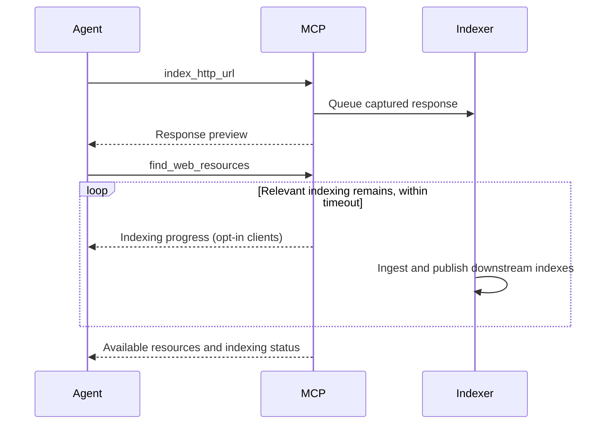

# Tool reference

[README](../README.md) · [Documentation index](README.md)

## Scan rate limits

`spider_website` and `directory_buster` accept optional `rate_limit_requests_per_second`.
Only non-negative integers or `null` are accepted; booleans, strings, fractions, and negative
values are rejected before work is queued.

| Input | Public target | Non-public target |
|-------|---------------|-------------------|
| Omitted or `null` | 5 requests/second | Preserve scanner defaults |
| Positive integer | Use supplied requests/second | Use supplied requests/second |
| `0` | Katana 3000 requests/second; directory busting unlimited | Katana 3000 requests/second; directory busting unlimited |

The budget applies independently to each scan. Public targets are registrable public domains
or globally routable IP literals, including IPv6. Detection uses the URL hostname/IP without
DNS resolution and does not consider registered hostname address overrides.

Katana receives no rate flag when the resolved limit is absent, preserving its built-in default.
Explicit zero maps to 3000 requests/second because Katana 1.5.0 crashes with a literal zero.
This is a high finite ceiling, rather than truly unlimited crawling, and requires no Katana patch.
Positive limits use Katana's requests/second flag. Directory busting
uses feroxbuster's rate limit with one active directory scan for positive limits, or ffuf's
requests/second flag for FUZZ scans. Explicit zero also disables feroxbuster auto-tuning;
omitted non-public limits retain its existing auto-tuning behavior.

Rate limiting uses each scanner's native scheduling, rather than guaranteeing evenly spaced
requests. Concurrency, server latency, retries, and scanner behavior affect observed traffic.
Existing spider cache reuse still applies: requesting a different limit does not force a new
crawl when recent indexed results are reused. Pagination does not start another scan.

## Result limits and saved pages

List tools return a first page and optional `pagination` metadata. Use
`get_result_page(page_token)` with `pagination.next_page_token` or
`pagination.previous_page_token` to navigate the same saved result without repeating a query or scan.
The paging tool returns `{ "source_tool": "...", "result": { ... } }`; `result` uses the producing
tool's response schema. Tokens are opaque bearer capabilities: anyone holding a token can read its
saved page through this server. Keep tokens private.

| Tool                                        | Default page size   | Saved result                                               |
|---------------------------------------------|---------------------|------------------------------------------------------------|
| `find_web_resources`                        | 20 resources        | Up to `retrieval_limit` matches (default 1,000)            |
| `query_findings`                            | 10 full findings    | All scoped findings, or up to 1,000 ranked semantic matches |
| `find_urls`                                 | 100 URLs            | All matching unique URLs                                   |
| `find_wordlists`                            | 20 paths            | All matching ranked paths                                  |
| `find_domains`, `find_hosts`, `find_netloc` | 100 records         | All matching unique records                                |
| `spider_website`                            | 50 resources        | Results collected before this call returns                 |
| `directory_buster`                          | 100 URLs            | Results collected before this call returns                 |
| `port_scan`                                 | 100 service records | Available structured scan results                          |
| `index_http_url`                            | 16,384 characters   | Complete textual response, after JavaScript transformation |
| `deobfuscate_javascript`                    | 8,192 characters    | Complete transformed script, or original script on failure |
| `fetch_web_resource_content`                | 4,096 characters    | Existing offset-based retrieval                            |

Predicate searches in `find_web_resources` use indexed derived metadata for HTTP methods,
file extensions, response MIME types, schemes, and case-sensitive URL trigrams. Qdrant narrows
candidates before exact predicate verification; `inurl:` retains substring matching across the
full URL, including query strings. Short substrings and negative substring/path conditions are
verified in Python. Candidate reads use only small metadata fields, with 256 records per page;
headers and bodies are fetched only for selected results. MIME predicates use the original
response MIME across network, forms, content, and chunk representations. This works in low-power
mode without document-type indexing. DEBUG logs report per-collection candidate counts and timings.

Direct URL, host, and network-location resource searches also select small metadata records before
fetching content, preserving exact URL variants, descendant prefixes, and newest unique captures.
Content reads and finding queries omit embeddings. HTTP content lookups select the first matching
point in ascending point-ID order, as before; opaque `web://` reads fetch only URL metadata before
the indexing wait and refresh the document afterward. Finding queries still collect complete markdown
results before saving pages.

Domain, host, and URL inventories prefilter their facets with indexed trigrams, then verify exact
substring or suffix semantics. Host suffix matching remains literal, including partial DNS labels;
domain matching is case-insensitive, and URL matching is case-sensitive. Host/domain trigram fields
are derived from lowercase canonical metadata. Strings shorter than three characters use exact
Python verification without trigram prefilters.

Spider freshness checks filter the last 24 hours and URL candidates in Qdrant, read only URL and
timestamp metadata newest-first, and stop after 11 qualifying records. The 1,000-record safety bound
applies after server-side narrowing. Database read failures propagate instead of being treated as
missing resources or permission to start another spider.

Existing HTTP collections must be recreated and reindexed before using these search fields.
There is no automatic deletion, backfill, or legacy-data fallback. Replaying into populated
collections is insufficient because duplicate-ID checks can skip existing records. Derived URL
trigrams increase payload/index storage and ingestion work; embeddings are unchanged.

Domain, host, network-location, and URL inventories use Qdrant keyword-index facets to retrieve
unique values rather than downloading metadata for every capture. Host and port filters constrain
URL and network-location retrieval; domain contains, host suffix, and URL path matching retain
their existing semantics. Complete inventories are collected before saved-page pagination, so
`limit` controls page size rather than database work. Each facet request has a 10-second deadline;
query execution is separate from the indexing wait. DEBUG logs report facet timings and value counts.
Existing collections acquire missing indexes at document-store initialization, including the integer
port index. No document reingestion is required.

List `limit` arguments control page size and accept 1–1,000. `find_web_resources` separately accepts
`retrieval_limit` from 1–1,000; `pagination.retrieval_truncated` reports when additional matches were
excluded by that cap. Narrow the query to retrieve other matches. Cached spider responses similarly
save at most 1,000 resources. Results preserve their original ordering throughout navigation.
Counts limit records, not total serialized bytes; full findings and headers can still be large.

`pagination` includes one-based `page_number`, `page_size`, `total_items`, `total_pages`, `expires_at`,
`next_page_token`, `previous_page_token`, and `retrieval_truncated`. Text totals and limits count
Unicode characters. First pages have no previous token and last pages have no next token. Empty
results have no snapshot and `pagination` is null. Nonempty single-page results are saved with both
navigation tokens null.

For example, call `find_urls` with:

```json
{"host_query": "example.com", "limit": 10}
```

Then pass the returned `pagination.next_page_token` to:

```json
{"page_token": "<opaque token from the response>"}
```

`scan_complete` describes scan completion, independently of saved-page navigation.
A page token accesses only results available when that snapshot was created. Scanning and indexing
continue after a tool's wait timeout; later scan calls create separate snapshots. Use indexed search
for discoveries made after the original call returned.

`port_scan` returns structured `results` instead of embedding XML (`nmap_xml` is null).
Its `nmap_xml_page_token` retrieves the first saved XML fragment through `get_result_page`.
Follow navigation tokens and concatenate the `result.text` fragments in order to reconstruct the
complete XML; individual fragments need not be valid XML documents. XML fragments are 8,192 characters.

`deobfuscate_javascript` returns an object with `text`, `mime_type`, `offset`, `total_length`,
`pagination`, and `transformation_status`. `find_wordlists` returns `paths` and `pagination`.
`index_http_url.content_length_limit` controls preview characters, default 16,384, and no longer
omits large bodies or limits indexing. All textual response bodies are submitted for indexing,
including responses without `Content-Length`. Preview limits apply after JavaScript transformation.
Binary responses return metadata only. `deobfuscate_javascript.output_length_limit` defaults to 8,192.
Both preview overrides accept 1–4,194,304 characters. `fetch_web_resource_content` retains
`output_start_position`, `output_length_limit`, and its offset-based partial-content fields, including `contents.has_more`.

`index_http_url` treats a missing or empty response `Content-Type` as unknown and includes the decoded body.
It accepts HTTP and HTTPS URLs; invalid URLs and request inputs raise explicit tool errors, as does
disabled open-world access. Connection failures, timeouts, protocol failures, and excessive redirects
return null. HTTP 4xx/5xx responses are still indexed. Redirects are not followed by default; enable
`follow_redirects` only when destinations are in scope.
If JavaScript transformation encounters a filesystem or subprocess failure, the preview retains the
original response text. Queue failures report that fetching succeeded but queueing failed.
Preview storage failures report that ingestion was already queued; repeating the call may enqueue
the same response again. These stages do not automatically retry.

`deobfuscate_javascript.transformation_status` is `empty` for blank input, `succeeded` when
the transformation command succeeds, and `failed` when it fails and returns the original input.
Success does not guarantee complete source recovery. The status is preserved on saved pages.
Older saved results without a status report `unknown`.
Indexed JavaScript has already undergone automatic transformation; repeat it only when warranted.

For `fetch_web_resource_content`, when `contents.has_more` is true, request the next chunk with
`output_start_position = contents.offset + len(contents.text)`. This tool uses character offsets
rather than saved-page tokens. It reads indexed content without contacting the target.

Pending scans can return no resources while `scan_complete=false`; this does not establish that
the target is unreachable. Avoid starting duplicate scans. `port_scan.retry` is deprecated and
ignored; repeated calls with the same parameters retrieve cached or pending results, without a
forced rescan. Indexing is asynchronous; retrieval tools wait briefly for relevant queued work and report when
results may still be incomplete.

Findings returned by `query_findings` may be unverified or outdated. Review their evidence before
treating them as confirmed vulnerabilities. New findings should include
evidence and verification status, with unavailable details marked explicitly. `save_finding`
acknowledges queuing for asynchronous persistence; immediate queries may not include the finding.

The shared saver suppresses repeated submissions from MCP, `/findings`, and JavaScript scanners
before title generation, embedding, and downstream indexing. Matching uses a versioned fingerprint
of the target and Markdown, excluding titles and timestamps. It normalizes Markdown line endings
and surrounding whitespace, hostname and URL-scheme case, HTTP(S) default ports, and empty URL
paths to `/`. Path case, query strings (including ordering), fragments, and evidence content are
preserved. A hostname target and its root URL are distinct. Rewritten reports or new evidence are
separate submissions; matching does not use semantic similarity.

The first saved finding retains its title, content, and timestamp. Responses still acknowledge
queuing and do not report whether a submission is a duplicate. Findings saved before fingerprinting
was introduced do not suppress new submissions, and historical duplicates are left intact.
Scanner-provided IDs retain their existing update behavior for changed content.

A data-directory file lock serializes finding saves across local workers. The primary record tracks
pending downstream handoff; a repeated submission can finish an interrupted handoff without
regenerating or embedding the finding. Queue delivery is at least once, using deterministic chunk
checks to tolerate replay. Coordinate all workers through the same data directory; independent
servers with separate data directories do not share this lock.

Saved pages live in `<server cache_path>/result_pages`, outside per-client working directories, and
survive session closure and server restarts. Expiration is fixed at creation; reading pages does not
extend it. Expired, missing, or corrupt results require repeating the original operation. Cleanup
runs before serving requests, at shutdown after workers drain, and before each new paginated query,
scan, or content operation. Unexpired snapshots remain on shutdown. No periodic background cleanup
runs while the server is idle. This store follows the server's single-process deployment model.

| Environment variable      | Default                        | Description                                                                                                                                   |
|---------------------------|--------------------------------|-----------------------------------------------------------------------------------------------------------------------------------------------|
| `TOOL_CACHE`              | Unset; uses `<data-dir>/tool_cache` | Compose compatibility override: parent of `tool_cache`; Compose retains its `/tool_cache` volume |
| `TOOL_RESULT_TTL_SECONDS` | `86400`                        | Positive integer retention in seconds for newly created snapshots; existing expiration times remain unchanged                                 |

For Docker Compose, set `TOOL_RESULT_TTL_SECONDS` in `.env` and restart the service. Both Compose
configurations retain saved pages in the existing `tool_cache` volume.

## Waiting for indexing

Web-resource search, content fetch, domain/host/netloc/URL inventories, and application-graph
discovery/traversal tools wait up to 60 seconds for indexing relevant to their query before reading
available data. Indexing and scan tools still return promptly after queueing work. Unrelated targets do not delay scoped
queries; an unfiltered inventory considers all targets. Finding queries, graph evidence retrieval,
direct MCP resource reads, and saved-page navigation do not wait.

| Environment variable | Default | Description |
|----------------------|---------|-------------|
| `INDEXING_WAIT_TIMEOUT_SECONDS` | `60` | Finite, nonnegative seconds to wait for relevant indexing per retrieval call; `0` disables waiting |

`--indexing-wait-timeout-seconds` overrides the environment. Both Compose configurations accept the
variable from `.env`; restart the service after changing it. The timeout covers the indexing wait,
including nested lookups, separately from the normal query's execution time.



Progress notifications describe elapsed time and pending/processing counts immediately upon waiting,
every five seconds during the wait, and when the wait ends. Clients must opt into MCP progress to
receive them. Cancellation stops the wait without cancelling indexing.

Covered results include `indexing.status`, `waited_seconds`, `potentially_incomplete`, per-stage
`stages` counts (`pending`, `processing`, `failed`), and `skipped_stages`. Status is `complete`,
`timed_out`, `paused`, `failed`, `unavailable`, or `disabled`. Only `complete` establishes that no
relevant outstanding or failed indexing work was observed; it does not guarantee exhaustive analysis.
A timeout returns currently available data and does not stop workers. Failed items do not prolong
the wait. Unresolvable queue metadata or status-read errors report `unavailable`, rather than success.

Content fetch retains its content fields and adds `indexing`. If no content is available while
indexing is incomplete, it returns only `{ "indexing": { ... } }`; a confirmed miss remains `null`.
With waiting disabled, missing content retains the previous `null` behavior. Graph evidence retrieval
does not wait or return indexing status; missing evidence returns `null`. Saved pages preserve the
original indexing status and never wait again.

Semantic search and explicit type filters such as `type:javascript` also wait for type-specific
indexing. Low-power mode skips deliberately paused type-specific indexing and reports outstanding skipped work
as `paused`; ingest and graph stages still wait normally. Graph waits include known script and
source-map dependencies of scoped documents, including dependencies on other origins. Opaque content
URIs use their indexed URL when available; if a missing URI cannot be related to outstanding ingest,
status is `unavailable`. Scope metadata is backfilled for active and failed legacy queue records
before workers start; queue payloads and records are preserved.

New relevant indexing arriving during a wait is included, so continuous ingestion for the same scope
may consume the full timeout. A completed wait does not wait for scans to discover future resources.
Do not start duplicate scans because an indexing wait timed out.

## Search predicates

`find_web_resources` accepts hard filters alongside natural-language queries. Predicates apply before semantic
ranking and are combined with AND, including repeated predicates. Prefix a predicate with `-` to exclude matches;
quote values containing spaces. Content and title analysis remains part of the natural-language query.

| Predicate           | Meaning                                                                                                      | Example                                                                      |
|---------------------|--------------------------------------------------------------------------------------------------------------|------------------------------------------------------------------------------|
| `site:`             | Hostname and its subdomains, or an exact IP; optionally restrict port, scheme, and URL path prefix           | `site:example.com`, `site:example.com:8443`, `site:https://example.com/app/` |
| `inurl:`            | Case-sensitive literal substring anywhere in the URL, including the query string                             | `inurl:admin`, `-inurl:"logout page"`                                        |
| `filetype:`, `ext:` | Case-insensitive final path extension; ignores query strings and fragments                                   | `filetype:js`                                                                |
| `mime:`             | Exact response MIME type, ignoring case and parameters                                                       | `mime:application/json`                                                      |
| `method:`           | HTTP request method, ignoring case; intersects with the `http_methods` argument                              | `method:POST`                                                                |
| `status:`           | Exact HTTP response status code from 100 to 599                                                              | `status:403`                                                                 |
| `type:`             | Indexed representation: `html`, `javascript`, `css`, `xml`, `json`, `network`, `forms`, `content`, `default` | `type:network`                                                               |

Examples:

```text
site:example.com filetype:js -inurl:vendor potential unsafe eval calls
site:example.com status:403 method:GET
site:example.com mime:application/json -inurl:logout
site:[::1]:8080 type:network
```

Positive `site:` predicates supply the target and take precedence over target inference. A hostname scope includes
all indexed ports unless a port is specified. A URL scope additionally restricts scheme and path prefix.
Other explicit predicates override inferred constraints for the same attribute. Conflicting filters return no matches.
Exclusions alone do not supply a target; existing target selection and confirmation behavior still applies.

Queries containing only predicates retrieve indexed results without LLM calls and work in low-power mode.
Queries with remaining natural-language text use semantic retrieval and require normal power mode.
These are Google-style conveniences with the semantics above; Boolean expressions, date and technology predicates,
`intitle:`, and `intext:` are not parsed as hard filters. Unrecognized syntax remains in the natural-language query.
Filtering uses existing indexed metadata without a migration; broad URL filtering can require a metadata scan.
When a target has indexed documents but nothing matches, the tool suggests broadening the query or relaxing filters.
Index-population guidance is reserved for targets with no indexed documents.


## Finding submissions

`save_finding` and HTTP `POST /findings` commit submissions to the persistent
`scan_finding_queue` before returning success. Pending items survive restarts. Processing runs
asynchronously; a successful submission may not be searchable immediately. Failed items remain
available for retry using the dashboard's `f` key. Exact duplicates keep the first saved finding.

## Finding search predicates

`query_findings(query, limit=10, score_threshold=None)` accepts a standalone
target or scope predicates with optional semantic text. Predicate expressions
require a positive `site:` and support `inurl:`, `filetype:`/`ext:`, quoted values, and `-`
exclusions. Predicates combine with AND, including repeated predicates, using the resource-search
case and matching rules above. Remaining text enables semantic retrieval within the explicit scope.
`mime:`, `method:`, `status:`, and `type:` do not describe affected resources in saved finding
metadata and are not supported. Ordinary scoped retrieval is deterministic and works in low-power mode.

```json
{"query":"site:example.com"}
{"query":"site:example.com inurl:admin -ext:js"}
{"query":"site:https://example.com/app/ filetype:js"}
```

Plain HTTP(S) root URLs search their hostname and subdomains across schemes and ports, retaining
an explicitly supplied port: `https://example.com/` is equivalent to `example.com`, while
`https://example.com:8443/` becomes `example.com:8443`. Other plain targets behave as `site:`
scopes. Non-root URLs restrict scheme and URL path prefix. An explicit `site:https://example.com/`
retains the HTTPS restriction. IP scopes match exactly; hostname scopes match label boundaries.
URL scopes use prefix matching rather than the former exact-URL lookup. Domain scope includes
matching subdomains even when findings exist on the domain's own host.

Hostname searches include findings saved against bare hosts or host:port. Scheme/path, `inurl:`,
and extension filters use the actual saved target URL, not URLs mentioned in Markdown.
Non-URL findings cannot satisfy positive URL filters; exclusions remove only actual matches.
Use exhaustive scoped retrieval for complete reviews, especially for vulnerability
chains: URL filters omit host-level findings and findings at other endpoints. Assessment prompts
use explicit `site:` scopes to preserve the user's scheme, path, and port restrictions.

The rebuilt finding collection uses metadata version 2 with keyword indexes for
`meta.search_host_suffixes`, `meta.search_extension`, `meta.search_scheme`, and
`meta.search_url_trigrams`. New indexes disable extra HNSW edges; equality-only integer indexes
use lookup without range indexing. Indexed candidate filters are followed by exact verification;
short substrings and negative substring filters may examine more scoped metadata. Only matched
finding bodies are retrieved. The `limit` argument sets page size; semantic searches also apply a total retrieval cap.

Stop the service before rebuilding the finding collection, then replay retained finding submissions
through the updated saving pipeline before querying. An index-only rebuild does not populate the
new metadata: findings must be saved again. Version 1 records are intentionally excluded. There is
no automatic migration, backfill, or compatibility scan, and startup does not delete the collection.
Retain source findings or recovery exports before replacing the collection; see
[ingestion recovery](ingestion-recovery.md) for recovering available submissions.

### Semantic finding queries

Combine natural-language text with scope predicates in the required `query`:

```json
{"query":"site:example.com authentication bypass and session fixation"}
{"query":"site:example.com -ext:js authorization bypass"}
```

The query argument is required and must contain a valid scope. Blank queries are rejected.
Predicate-only expressions and standalone targets use ordinary scoped retrieval and ignore
`score_threshold`, including numeric range checks. Semantic search has a fixed cap of 1,000 matches;
there is no `retrieval_limit` argument. With semantic text, an optional `score_threshold` must be
finite and between -1 and 1. Thresholds are model-dependent; no cutoff is applied by default.
`limit` always controls page size. Semantic searches require positive `site:` scope. Only the
remaining natural-language text is embedded; scope predicates are applied as hard filters.
Standalone hostname, IP, host:port, and URL queries retain the scope shorthand described above.
Use explicit `site:` when combining scope with prose; scope is never inferred from semantic text.
The former `target` argument and response-level `target` have been removed without an alias.
Responses echo the complete submitted `query`; each finding still includes its own `target`.

Semantic search verifies scoped metadata, embeds the query with the finding model, and uses exact
dense-vector search over eligible IDs in the primary collection. Only selected bodies are loaded.
Existing embeddings and indexes are reused; enabling semantic retrieval requires no additional
rebuild or replay. Search quality reflects existing embeddings, which may omit later sections of
long findings. Missing or incompatible vectors require correcting the embedding configuration or
replaying affected findings; retrieval errors are not replaced with unranked results.

Each semantic finding includes a cosine `score`; ordinary retrieval uses null. Scores describe
similarity, not vulnerability confidence. Pages preserve the ranked snapshot. `pagination.total_items`
counts retrieved results, not all site findings; `pagination.retrieval_truncated` means more qualifying
results exceeded the cap. Whenever 1,000 results are retrieved, instructions ask the caller to
narrow the search, including when exactly 1,000 qualify. A null next-page token exhausts only that snapshot. Use focused queries
for investigations and use predicates only for an exhaustive scoped review.

Semantic retrieval requires normal power mode. In low-power mode, use predicate-only queries to retrieve findings
without embeddings. Search reports scope counts and embedding, ranking, and loading stages, with
idle heartbeats after 20 seconds without updates. Clients need not support progress notifications.

## Structured findings and investigation targets

`save_finding(target, markdown, title, metadata=null)` accepts the optional structured finding object
also accepted by HTTP `/findings`. `query_findings` returns stable `finding_id`, `metadata`, and
`metadata_conflicts` fields. Metadata is optional for all producers; the affected request method is
`metadata.affected_method`, independent of the HTTP POST used to submit findings.

`find_investigation_targets(scope, vulnerability_type=null, include_hypotheses=true, limit=20)` reads
background materialization. Scope uses graph hostname/port/URL-prefix semantics; category filters use
normalized names rather than semantic text. Results include witnesses, evidence IDs, numeric priority
contributions, coverage gaps, freshness/status, and focused follow-up calls. `limit` is saved-page size
(1–1,000); follow page tokens with `get_result_page`. Queries never contact applications or start scans.

See the [complete finding contract and investigation guide](investigation-targets.md#finding-submission-contract)
for field types, normalization, adapter mappings, lifecycle, and scoring/chain policies. This is finding
storage version 3: preserve existing assessments and replay into fresh storage; no automatic migration.
